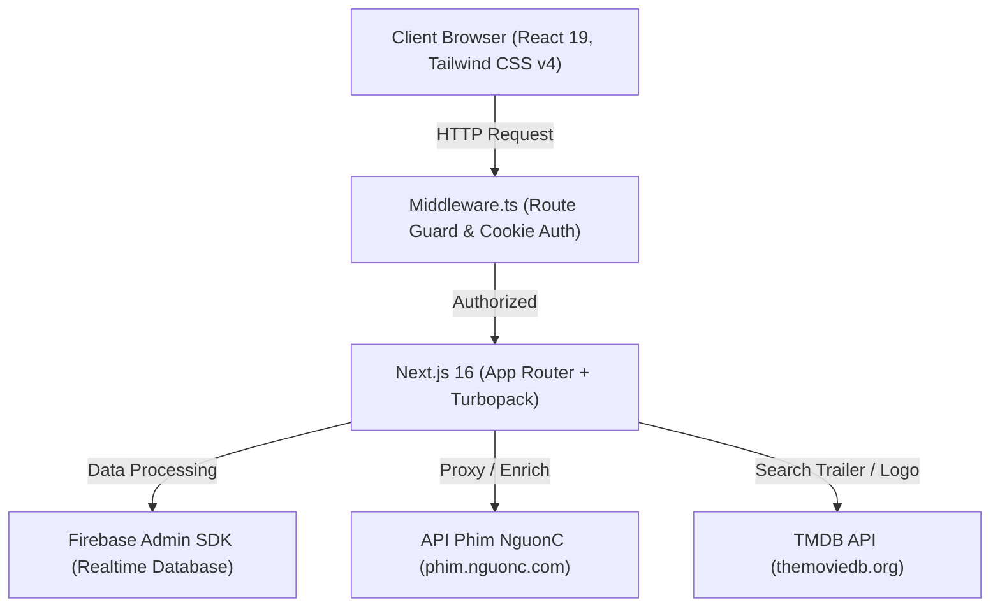

# 🏗️ 01.1 - Kiến Trúc Hệ Thống & Tổng Quan Dự Án

<< [[00 - NetLix Brain - Map of Content (MOC)|Trang Chủ MOC]] | [[01.2 - Quy Trinh Nghiep Vu Xem Phim & Luong Du Lieu|Tiếp: Quy Trình Nghiệp Vụ >>]]

---

## 🎯 1. Giới Thiệu & Mục Tiêu Dự Án
**NetLix** (còn gọi là *Lixfnet*) là nền tảng streaming phim trực tuyến chất lượng cao, mô phỏng hoàn hảo trải nghiệm người dùng đẳng cấp của Netflix:
- **Trải nghiệm Cinema cao cấp**: Giao diện tối (Dark mode) sang trọng, hiệu ứng chuyển cảnh mượt mà, micro-animations, poster/backdrop độ nét cao.
- **Dữ liệu phong phú theo thời gian thực**: Tích hợp trực tiếp với API của **Phim NguonC** (hàng ngàn tựa phim bộ, phim lẻ, anime, truyền hình) kết hợp **The Movie Database (TMDB)** cho ClearLogo & trailer YouTube.
- **Cá nhân hóa sâu**: Lưu tiến trình xem phim (Watch Progress), tiếp tục xem (Continue Watching), danh sách yêu thích (My List) và thuật toán đề xuất phim theo gu (Taste Profile).
- **Hệ thống bảo mật riêng tư**: Xác thực tài khoản với Firebase Realtime Database, phân quyền Quản trị viên (Admin) và Thành viên (Member).

---

## 💻 2. Công Nghệ & Tech Stack



| Tầng Công Nghệ | Công Nghệ Lựa Chọn | Vai Trò & Lý Do Lựa Chọn |
| :--- | :--- | :--- |
| **Framework** | **Next.js 16.4.2 (Turbopack)** | Server-side rendering (SSR), Route Handlers, Turbopack biên dịch siêu tốc, tối ưu SEO và load trang. |
| **Core UI** | **React 19.3.0** | Hỗ trợ hooks thế hệ mới, concurrent rendering, tương thích cao nhất với Next.js 16. |
| **Styling** | **Tailwind CSS v4** | Cấu hình `@theme`, class tiện ích hiện đại, tốc độ render cao, hỗ trợ responsive hoàn hảo. |
| **Iconography** | **Lucide React (^1.60.0)** | Bộ icon vector hiện đại, dung lượng nhẹ, tree-shakeable. |
| **Database** | **Firebase Realtime Database** | Lưu trữ hồ sơ người dùng, phân quyền, đồng bộ tiến trình xem phim thời gian thực (realtime sync). |
| **Backend SDK** | **Firebase Admin SDK (^14.5.0)** | Thao tác server-side an toàn tuyệt đối với Secret Key, không lộ credentials ra client. |
| **Bảo Mật** | **Bcryptjs (^3.0.3)** | Băm mật khẩu (hashing) chuẩn công nghiệp `saltRounds = 10` trước khi lưu vào database. |
| **Ngôn Ngữ** | **TypeScript 5** | Định kiểu tĩnh chặt chẽ (Strict Mode), giảm thiểu lỗi runtime. |

---

## 📁 3. Cấu Trúc Thư Mục Chuẩn Hóa

```
netlix/
├── app/                          # Next.js App Router (Pages & API Routes)
│   ├── api/                      # Backend Endpoints
│   │   ├── auth/                 # Xác thực & Quản lý tài khoản
│   │   │   ├── login/route.ts    # Đăng nhập, băm bcrypt, cấp cookie
│   │   │   ├── logout/route.ts   # Đăng xuất, xóa cookie
│   │   │   ├── me/route.ts       # Kiểm tra phiên hiện tại
│   │   │   ├── users/route.ts    # Lấy danh sách users (Admin)
│   │   │   ├── create-user/      # Tạo tài khoản mới (Admin)
│   │   │   └── delete-user/      # Xóa tài khoản (Admin)
│   │   ├── logo/route.ts         # Endpoint phân giải Title Logo TMDB
│   │   ├── trailer/route.ts      # Endpoint tìm kiếm trailer YouTube TMDB
│   │   └── user/progress/        # Đồng bộ tiến trình xem (GET, POST, DELETE)
│   ├── browse/                   # Các trang duyệt phim phân loại
│   ├── latest/page.tsx           # Trang Phim Mới & Thịnh Hành
│   ├── login/page.tsx            # Trang Đăng nhập điện ảnh
│   ├── movies/page.tsx           # Trang Phim Lẻ
│   ├── series/page.tsx           # Trang Phim Bộ
│   ├── my-list/page.tsx          # Trang Danh Sách Của Tôi
│   ├── layout.tsx                # Root Layout (NetflixProvider, fonts, metadata)
│   └── page.tsx                  # Trang Chủ (HeroBanner, MovieRows, Top 10)
├── components/                   # Hệ Thống UI Components
│   ├── auth/                     # CreateUserModal (Quản trị tài khoản)
│   ├── cards/                    # MovieCard, Top10Card, ContinueWatchingCard, HoverPopoutCard
│   ├── hero/                     # HeroBanner (Trailer background, Title logo)
│   ├── layout/                   # Navbar, Footer, AppShell
│   ├── modals/                   # MovieModal (Chi tiết phim, tập phim, phim tương tự)
│   ├── player/                   # VideoPlayerModal (Trình phát phim chuẩn rạp)
│   ├── rows/                     # MovieRow, RowSkeleton
│   ├── search/                   # SearchResults (Tìm kiếm thời gian thực)
│   └── ui/                       # Badge, NetflixLogo, Top10Number
├── context/                      # State Management
│   └── NetflixContext.tsx        # Trái tim State toàn cục (Player, Modal, Auth, Audio)
├── data/                         # Dữ liệu tĩnh dự phòng
│   └── moviesData.ts             # Fallback demo movies, categories
├── lib/                          # Tiện ích phía Server
│   └── firebaseAdmin.ts          # Khởi tạo Firebase Admin & CRUD helper
├── services/                     # Business Logic Services
│   ├── movieApi.ts               # Kết nối API NguonC, chuẩn hóa thời lượng, tags
│   ├── logoService.ts            # Tìm kiếm & xếp hạng Title Logo TMDB (vi > en > any)
│   ├── recommendationEngine.ts   # Thuật toán phân tích gu (Taste Profile) & gợi ý
│   └── collectionService.ts      # Gom nhóm bộ sưu tập (MCU, K-Drama, Anime...)
├── types/                        # Định nghĩa TypeScript
│   └── index.ts                  # Movie, Episode, WatchProgress, NguonC API models
├── middleware.ts                 # Bảo vệ route, chặn truy cập khi chưa đăng nhập
├── firebasekey.json              # Service Account Key của Firebase (Local Dev)
└── next.config.ts                # Cấu hình Next.js
```

---

## 🔄 4. Luồng Dữ Liệu Tổng Thể (Data Flow)

1. **Khởi Động & Xác Thực**:
   - Người dùng truy cập bất kỳ route nào -> `middleware.ts` kiểm tra cookie `lixfnet_session`.
   - Nếu chưa đăng nhập -> Chuyển hướng ngay đến `/login`.
   - Đăng nhập thành công -> Lưu cookie HttpOnly thời hạn 30 ngày.

2. **Tải Dữ Liệu Trang Chủ**:
   - Client gọi `getNewUpdatedMovies()`, `getSeriesMovies()`, `getSingleMovies()`, `getAnimeMovies()` từ [movieApi.ts](file:///c:/Users/trong/Downloads/Code/NetLix/netlix/services/movieApi.ts).
   - [movieApi.ts](file:///c:/Users/trong/Downloads/Code/NetLix/netlix/services/movieApi.ts) gọi API NguonC, phân tích thời lượng, gắn nhãn chất lượng, chuẩn hóa tên tiếng Việt/Anh.
   - [recommendationEngine.ts](file:///c:/Users/trong/Downloads/Code/NetLix/netlix/services/recommendationEngine.ts) đọc `watchProgressMap` của người dùng, tự động tính toán điểm phù hợp và đảo các hàng phim được yêu thích lên đầu.

3. **Tương Tác Phim & Xem Trước (Trailer Popout)**:
   - Khi hover vào một thẻ phim sau 400ms: [HoverPopoutCard.tsx](file:///c:/Users/trong/Downloads/Code/NetLix/netlix/components/cards/HoverPopoutCard.tsx) xuất hiện.
   - Tự động gọi `/api/trailer` để tìm key YouTube trailer và `/api/logo` để lấy logo nghệ thuật TMDB.
   - Âm thanh được đồng bộ theo sở thích toàn cục `isMuted` trong [NetflixContext.tsx](file:///c:/Users/trong/Downloads/Code/NetLix/netlix/context/NetflixContext.tsx).

4. **Trình Phát Phim & Lưu Tiến Trình**:
   - Khi bấm **Phát**: [VideoPlayerModal.tsx](file:///c:/Users/trong/Downloads/Code/NetLix/netlix/components/player/VideoPlayerModal.tsx) mở toàn màn hình.
   - Nhúng stream iframe trực tiếp từ NguonC hoặc fallback video HTML5.
   - Cứ mỗi 5 giây, tiến trình xem (giây hiện tại, tổng thời lượng, tập phim) được gửi về `/api/user/progress` để lưu vào Firebase Realtime Database và `localStorage`.
