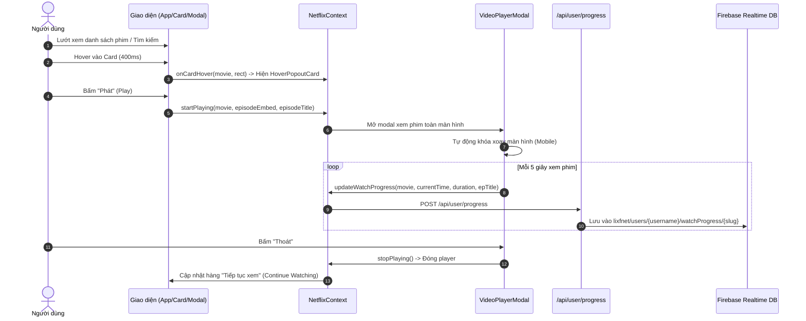

# 🎬 01.2 - Quy Trình Nghiệp Vụ Xem Phim & Luồng Dữ Liệu

<< [[01.1 - Kien Truc He Thong & Tong Quan Du An|<< Trước: Kiến Trúc Hệ Thống]] | [[00 - NetLix Brain - Map of Content (MOC)|Trang Chủ MOC]] | [[01.3 - He Thong De Xuat & Ca Nhan Hoa (Taste Profile)|Tiếp: Hệ Thống Đề Xuất >>]]

---

## 🧭 1. Sơ Đồ Quy Trình Nghiệp Vụ Người Dùng



---

## ⏱️ 2. Nghiệp Vụ Quản Lý Tiến Trình Xem (Watch Progress)

### 2.1 Cấu Trúc Dữ Liệu Tiến Trình
Mỗi bản ghi `WatchProgress` trong hệ thống được định nghĩa chặt chẽ trong `types/index.ts`:

```typescript
export interface WatchProgress {
  movieId: string;
  movieSlug?: string;
  movie: Movie;
  episodeTitle?: string;
  episodeEmbed?: string;
  currentTime: number;        // Giây đã xem
  duration: number;           // Tổng số giây của phim/tập
  progressPercent: number;    // % đã xem (0 - 100)
  updatedAt: number;          // Timestamp cập nhật gần nhất
  episodesProgress?: Record<string, EpisodeProgress>; // Tiến trình chi tiết từng tập
}

export interface EpisodeProgress {
  currentTime: number;
  duration: number;
  progressPercent: number;
  updatedAt: number;
  isCompleted?: boolean;
}
```

### 2.2 Quy Tắc Nghiệp Vụ (Business Rules)
1. **Khởi tạo tiến trình tức thì**: Ngay khi người dùng nhấn "Phát", hệ thống tự động ghi nhận phim vào `watchProgressMap` để phim xuất hiện ngay lập tức trong hàng **Tiếp tục xem**.
2. **Theo dõi chi tiết từng tập đối với Phim Bộ (Series)**:
   - Với phim bộ, hệ thống lưu tiến trình riêng biệt cho từng tập trong trường `episodesProgress[episodeTitle]`.
   - Khi người dùng quay lại xem phim bộ, hệ thống tự động phát tiếp tập phim gần nhất đang xem dở.
3. **Cơ chế khôi phục (Resume Playback)**:
   - **Video HTML5 (Demo/Trailer)**: Nếu người dùng đã xem quá 15 giây, khi mở lại sẽ hiển thị hộp thoại *"Tiếp tục xem?"* (cho phép xem tiếp từ mốc đã dừng hoặc xem lại từ đầu).
   - **Video Embed Iframe (API NguonC / PhimAPI)**: Hiển thị một Toast thông báo tinh tế *"Đang phát: Tập X"* ở phía trên, không làm gián đoạn luồng stream của player.
4. **Làm sạch khóa Firebase**:
   - Khóa lưu trên Firebase Realtime Database không được chứa các ký tự đặc biệt như `/`, `.`, `#`, `$`, `[`, `]`.
   - Hàm `saveUserWatchProgress` tự động thay thế các ký tự này bằng dấu gạch dưới `_`.

### 2.3 Nghiệp Vụ Chuyển Tập Tiếp Theo (Next Episode Transition Flow)
- **Kiểm soát an toàn cho tập mới nhất (Latest Episode Guard)**:
  - Chỉ kích hoạt khi tồn tại tập tiếp theo sẵn sàng trong cơ sở dữ liệu (`currentIndex + 1 < currentServer.items.length`).
  - Nếu người dùng đang xem tập mới nhất vừa chiếu (hoặc tập cuối của phim bộ), card Tập tiếp theo sẽ **tuyệt đối không hiển thị**, bảo vệ trải nghiệm của người xem.
- **Kích hoạt thông minh tại 90s cuối**:
  - Khi thời lượng còn lại $\le 90$ giây (`duration - currentTime <= 90`), card Tập tiếp theo xuất hiện êm dịu góc dưới bên phải.
- **Không tự động chuyển phim sau 10s**:
  - Không có bộ đếm ngược cưỡng ép chuyển tập; phim vẫn tiếp tục phát nhạc outro/after-credits bình thường.
  - Sau 5 giây nếu người dùng không bấm **[Phát ngay]**, card sẽ tự động mờ dần và ẩn đi nhẹ nhàng.
  - Bất cứ khi nào người dùng di chuột hoặc chạm màn hình, card sẽ hiện lại mượt mà và làm mới bộ đếm 5 giây.
  - Khi người dùng bấm **[Phát ngay]**, hệ thống ngay lập tức chuyển sang nạp luồng phát tập kế tiếp.

---

## 📌 3. Nghiệp Vụ "Tiếp Tục Xem" (Continue Watching)

- **Điều kiện hiển thị**:
  - Phim có trong `watchProgressMap`.
  - Tiến trình chưa hoàn thành 100% (hoặc được xem gần đây).
  - Được sắp xếp theo thứ tự thời gian giảm dần (`updatedAt` mới nhất nằm ở đầu danh sách).
- **Thẻ phim ContinueWatchingCard**:
  - Hiển thị thanh tiến trình màu đỏ đặc trưng của Netflix ở đáy thẻ.
  - Hiển thị nhãn tập phim đang xem dở (ví dụ: *"Tập 6"* hoặc *"Thời lượng còn lại: 24 phút"*).
  - Nút **Xem tiếp** (Resume) phát ngay từ tập và giây đang dừng.
  - Nút **Xóa khỏi danh sách** (Remove from row) xóa tiến trình khỏi cả `localStorage` và Firebase.

---

## ❤️ 4. Nghiệp Vụ "Danh Sách Của Tôi" (My List / My Netflix Hub)

- **Cơ chế Bookmark**:
  - Người dùng có thể bấm nút `+` (Thêm vào danh sách) hoặc dấu tích `✓` (Đã thêm) từ bất kỳ đâu: Banner chính, Card hover, hoặc Modal chi tiết.
  - Hàm `toggleMyList(movie)` trong [[04.1 - NetflixContext (State Toan Cuc)]] sẽ kiểm tra sự tồn tại của `movie.id`:
    - Nếu đã có -> Loại bỏ khỏi danh sách (gửi `DELETE /api/user/mylist`).
    - Nếu chưa có -> Thêm vào đầu danh sách (gửi `POST /api/user/mylist`).
- **Lưu trữ & Đồng bộ Đa Thiết Bị**:
  - Tự động lưu cache cục bộ vào `localStorage` theo khóa `netflix_my_list_{username}` để hiển thị tức thì (optimistic update).
  - Tự động đồng bộ lên Firebase Realtime Database tại `lixfnet/users/{username}/myList` thông qua API `/api/user/mylist`. Khi đăng nhập cùng tài khoản ở bất kỳ thiết bị/trình duyệt nào, toàn bộ danh sách sẽ được nạp về đầy đủ.
- **Trang `/my-list` Tổng Hợp Thông Minh**:
  - Tự động hiển thị cả 2 mục dữ liệu người dùng:
    1. **Tiếp tục xem**: Phim và tập đang xem dở kèm thanh tiến trình đỏ đặc trưng.
    2. **Phim đã lưu xem sau**: Các phim chủ động bấm nút `+` để lưu lại.
  - Bộ lọc Tab linh hoạt: `[Tất cả]`, `[Đang xem dở]`, `[Đã lưu xem sau]`.
  - Huy hiệu trạng thái: Báo hiệu kết nối `"Đồng bộ Cloud"` thời gian thực theo tài khoản đang đăng nhập.

---

## 🔊 5. Nghiệp Vụ Đồng Bộ Âm Thanh Toàn Cục & Âm Lượng Trailer (Audio & Volume Sync)

- **Vấn đề**: Người dùng không muốn bị giật mình vì tiếng trailer quá lớn (trước đây mặc định 100%), đồng thời cần công cụ tinh chỉnh mức âm lượng yêu thích mà không làm mất tính thẩm mỹ của video.
- **Giải pháp**:
  - **Mặc định 60% êm dịu**: Âm lượng trailer tự động khởi tạo ở mức **60%** thay vì 100%, tạo cảm giác dễ chịu, vừa vặn khi lướt web.
  - **Lưu trữ sở thích `trailerVolume`**: Lưu vào State toàn cục và `localStorage` (`netflix_trailer_volume_{user}` hoặc `netflix_trailer_volume`), duy trì bền vững cho mọi lần xem tiếp theo.
  - **Thanh trượt Kính Lỏng (Liquid Glass Slider) khi Hover**:
    - Khi rê chuột vào nút loa ở MovieModal hoặc HeroBanner, thanh điều khiển mở rộng ngang mượt mà (`backdrop-blur-xl bg-black/45 border border-white/30`).
    - Thanh trượt hiển thị chính xác % âm lượng và phản hồi tức thì với luồng video.
    - Kéo về 0% tự động chuyển sang chế độ tắt tiếng (`isMuted = true`); kéo lên > 0% tự động bật tiếng lại.
  - **Đồng bộ đa thành phần**: Thay đổi âm lượng và trạng thái tắt tiếng sẽ lập tức đồng bộ giữa HeroBanner, MovieModal và HoverPopoutCard.

---

## 🔍 6. Nghiệp Vụ Đối Soát Đa Nguồn (Cross-Reference Validation: Netflix Tudum ⟷ TMDB ⟷ NguonC)

Nhằm đảm bảo 100% phim hiển thị trên giao diện đều có thông tin chuẩn xác và có nguồn phát xem được:
1. **Làm sạch hậu tố mùa**: Tiêu đề cào từ Netflix Tudum thường có đuôi `: Season 1`, `: Limited Series`. Hàm `cleanMovieTitleForSearch` tự động lọc bỏ các đuôi này trước khi tìm kiếm.
2. **Từ điển ánh xạ có thẩm quyền (`NETFLIX_VN_TUDUM_DICTIONARY`)**: Các phim đặc thù hoặc có bản quyền độc quyền được liên kết trực tiếp bằng mã TMDB ID và slug NguonC chuẩn, triệt tiêu hoàn toàn khả năng nhận diện nhầm.
3. **So khớp chéo đa trường (Cross-Verification)**:
   - Khi tìm kiếm phim, hệ thống so sánh đồng thời: Tên tiếng Việt, Tên gốc tiếng Anh/Trung/Hàn/Nhật, Năm sản xuất ($\pm 1$ năm), Đạo diễn và Dàn diễn viên chính.
   - Tránh tuyệt đối trường hợp phim trùng tên tiếng Anh nhưng lại là phim khác (ví dụ: *Bunny!* giữa phim người đóng và hoạt hình *Thỏ Ơi!*).
4. **Kiểm tra nguồn phát thực tế (Episode Availability)**:
   - Hệ thống truy vấn trực tiếp số lượng tập phim phát sóng từ NguonC (`episodes.length > 0`).
   - Nếu phim chưa có nguồn phát hoặc chưa chiếu tập nào, tự động gắn tag **"Sắp chiếu / Chưa có sẵn"** để người dùng nắm rõ thông tin.
5. **Đồng bộ thể loại chuẩn**: Toàn bộ thể loại phim được trích xuất trực tiếp từ NguonC thay vì phỏng đoán, đảm bảo tính nhất quán cho thuật toán tính gu đề xuất ([[04.4 - recommendationEngine (Thuat Toan De Xuat)]]).

---

## 🏛️ 7. Nghiệp Vụ Phân Bổ Hàng Phim Nền Tảng (Multi-Platform Rows Architecture)

- **Độc lập nền tảng**: Mỗi platform (Netflix, Apple TV, HBO) được tách thành một hàng riêng biệt, có logo và nhận diện thương hiệu rõ ràng.
- **Phân bổ xen kẽ tự nhiên**: Các hàng nền tảng được thuật toán bố trí phân tán ngẫu nhiên xen kẽ giữa các hàng thể loại/quốc gia khác trên giao diện, tạo cảm giác khám phá đa dạng giống hệt ứng dụng Netflix gốc.
- **Thứ tự ưu tiên Top Netflix**: Hàng **Top 10 Phim & Series của Netflix** luôn luôn được ưu tiên đẩy lên vị trí cao nhất trên trang chủ so với các nền tảng khác.
- **Quy tắc Card đồng bộ**:
  - Toàn bộ card phim thông thường (quốc gia, thể loại, nền tảng) đều ở **dạng ngang 16:9**.
  - **Chỉ duy nhất các hàng Top 10** mới sử dụng **thẻ dạng dọc 2:3** với chữ số 3D khổng lồ để tạo điểm nhấn thị giác phân tầng rõ rệt.

