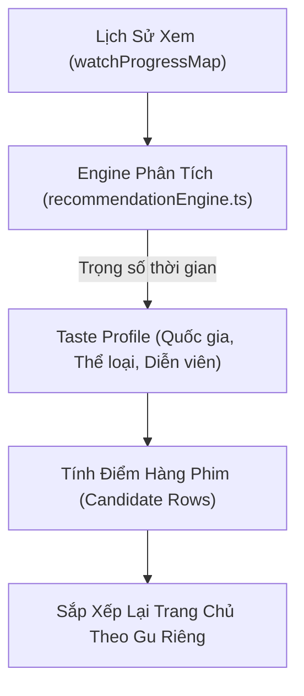

# 🎯 01.3 - Hệ Thống Đề Xuất & Cá Nhân Hóa (Taste Profile)

<< [[01.2 - Quy Trinh Nghiep Vu Xem Phim & Luong Du Lieu|<< Trước: Quy Trình Nghiệp Vụ]] | [[00 - NetLix Brain - Map of Content (MOC)|Trang Chủ MOC]] | [[01.4 - Xac Thuc Nguoi Dung & Phan Quyen (Auth & Session)|Tiếp: Xác Thực & Phân Quyền >>]]

---

## 💡 1. Mục Đích & Nguyên Lý Hoạt Động
Trong một ứng dụng phim phong cách Netflix, trải nghiệm cá nhân hóa là yếu tố quan trọng nhất để giữ chân người dùng. Thay vì hiển thị một thứ tự hàng phim cố định cho tất cả mọi người, NetLix xây dựng một **Hồ sơ sở thích động (Taste Profile)** dựa trên lịch sử xem phim thực tế.



---

## 🧮 2. Thuật Toán Xây Dựng Taste Profile (`buildTasteProfile`)

Nằm trong `services/recommendationEngine.ts`, hàm `buildTasteProfile` đọc toàn bộ các mục trong `watchProgressMap` và tính điểm theo các quy tắc:

### 2.1 Trọng Số Thời Gian (Recency Weighting)
Phim xem gần đây phản ánh sở thích hiện tại chính xác hơn phim xem từ lâu:
- **Xem trong vòng 7 ngày qua**: Nhân hệ số **1.5x**.
- **Xem từ 8 đến 30 ngày qua**: Nhân hệ số **1.2x**.
- **Xem trên 30 ngày**: Nhân hệ số chuẩn **1.0x**.

```typescript
const daysAgo = (now - (entry.updatedAt || now)) / (1000 * 60 * 60 * 24);
const recencyWeight = daysAgo <= 7 ? 1.5 : daysAgo <= 30 ? 1.2 : 1.0;
```

### 2.2 Điểm Số Quốc Gia (Country Preference)
- Mỗi lần xem phim của một quốc gia (ví dụ: *Hàn Quốc*, *Âu Mỹ*, *Nhật Bản*, *Việt Nam*, *Thái Lan*), quốc gia đó được cộng:
  $$\text{Score}_{\text{country}} += 3 \times \text{recencyWeight}$$
- Quốc gia có tổng điểm cao nhất sẽ trở thành `favoriteCountrySlug`.

### 2.3 Điểm Số Thể Loại (Genre Preference)
- Mỗi thể loại trong mảng `movie.genres` (ví dụ: *Hành động*, *Tình cảm*, *Kinh dị*, *Khoa học viễn tưởng*, *Hoạt hình*) được chuẩn hóa và cộng:
  $$\text{Score}_{\text{genre}} += 2 \times \text{recencyWeight}$$
- Hệ thống chọn ra top 3 thể loại có điểm cao nhất lưu vào `favoriteGenreSlugs`.

### 2.4 Điểm Số Diễn Viên (Actor Preference)
- Nếu phim có thông tin diễn viên (`movie.cast`), mỗi diễn viên được cộng $1 \times \text{recencyWeight}$.

---

## 📊 3. Thuật Toán Sắp Xếp Hàng Phim Trang Chủ (`getPersonalizedHomeRows`)

Khi trang chủ chuẩn bị hiển thị, danh sách các hàng phim ứng viên (`CandidateRow`) sẽ được chấm điểm ưu tiên:

1. **Hàng "Tiếp tục xem" (Continue Watching)**:
   - Luôn được ưu tiên hiển thị ở vị trí số 1 nếu có phim đang xem dở.
2. **Hàng Trùng Quốc Gia Yêu Thích**:
   - Nếu hàng phim thuộc quốc gia mà người dùng xem nhiều nhất (`candidate.countrySlug === profile.favoriteCountrySlug`), hàng này được cộng **+100 điểm ưu tiên**.
   - Ví dụ: Người dùng hay cày K-Drama -> Hàng *"Phim Hàn Quốc Thịnh Hành"* sẽ tự động nhảy lên ngay dưới Banner và hàng Tiếp tục xem!
3. **Hàng Trùng Thể Loại Yêu Thích**:
   - Trùng thể loại top 1 -> **+80 điểm**.
   - Trùng thể loại top 2 -> **+60 điểm**.
   - Trùng thể loại top 3 -> **+40 điểm**.
4. **Hàng Đề Xuất Dành Riêng ("Vì bạn đã xem...")**:
   - Tự động lọc ra 10-15 phim có độ tương đồng cao nhất với tựa phim gần nhất mà người dùng vừa xem và tạo thành một hàng chuyên biệt: *"Vì bạn đã xem [Tên Phim]"*.

---

## 🔍 4. Hàm Kiểm Tra Đặc Biệt: `isChineseMovie`
Nhằm tôn trọng quy định và sở thích của từng phân khúc người dùng, hệ thống cung cấp hàm `isChineseMovie` trong [[04.2 - movieApi Service (Logic Xu Ly Du Lieu)]] để lọc và kiểm soát hiển thị phim theo nhu cầu.
