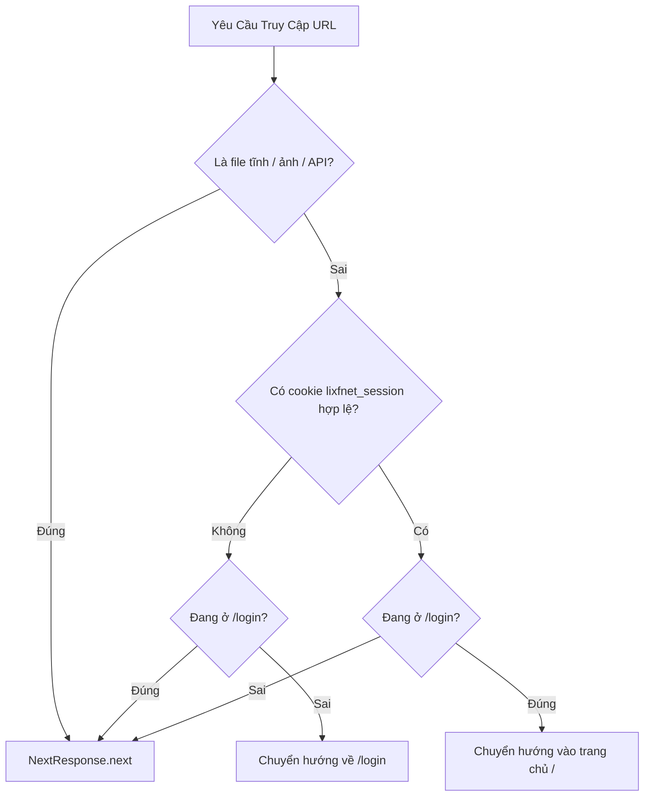

# 🔐 01.4 - Xác Thực Người Dùng & Phân Quyền (Auth & Session)

<< [[01.3 - He Thong De Xuat & Ca Nhan Hoa (Taste Profile)|<< Trước: Hệ Thống Đề Xuất]] | [[00 - NetLix Brain - Map of Content (MOC)|Trang Chủ MOC]] | [[02.1 - API NguonC (Danh Sach, Chi Tiet & Tap Phim)|Tiếp: API NguonC >>]]

---

## 🛡️ 1. Mô Hình Bảo Mật Khép Kín (Private Portal)
NetLix được thiết kế theo mô hình **Cổng Rạp Chiếu Riêng Tư (Private Streaming Portal)**:
- Người dùng **không thể tự do đăng ký tài khoản** trên giao diện công khai.
- Chỉ có **Quản trị viên (Admin)** mới có quyền tạo hoặc xóa tài khoản cho các thành viên trong gia đình hoặc bạn bè.
- Mọi trang trong ứng dụng (`/`, `/movies`, `/series`, `/my-list`, `/latest`, v.v.) đều được bảo vệ nghiêm ngặt bằng **Next.js Middleware**. Bất kỳ ai chưa đăng nhập đều bị tự động chuyển hướng về trang `/login`.

---

## 🚦 2. Cơ Chế Hoạt Động Của `middleware.ts`

Tệp `middleware.ts` ở thư mục gốc hoạt động như một người gác cổng (gatekeeper):



### Các quy tắc trong `middleware.ts`:
1. **Miễn trừ tài nguyên tĩnh & API**:
   - Các đường dẫn bắt đầu bằng `/_next`, `/api/`, `/images`, `/favicon`, `/icon`, hoặc có đuôi `.svg`, `.png`, `.jpg`, `.webp`, `.ico` được bỏ qua để tối ưu tốc độ.
2. **Kiểm tra Cookie `lixfnet_session`**:
   - Đọc giá trị cookie và parse JSON để xác minh trường `username`.
3. **Chặn truy cập trái phép**:
   - Nếu chưa xác thực và không ở trang `/login` -> Redirect ngay đến `/login`.
4. **Tránh lặp vô tận**:
   - Nếu đã đăng nhập mà vẫn cố truy cập `/login` -> Redirect vào `/`.

---

## 🔑 3. Quy Trình Đăng Nhập & Cấp Phiên (`/api/auth/login`)

Tệp `app/api/auth/login/route.ts` xử lý toàn bộ logic xác thực:

### 3.1 Tự Động Khởi Tạo Admin Mặc Định (Auto-Seed)
Khi triển khai dự án lần đầu trên database mới, nếu chưa có bất kỳ tài khoản nào:
- Hệ thống hỗ trợ tài khoản quản trị mặc định:
  - **Tên đăng nhập**: `tronglich`
  - **Mật khẩu**: `389363`
  - **Quyền**: `admin`
- Mật khẩu được tự động băm bằng `bcrypt.hash(password, 10)` trước khi ghi vào Firebase Realtime Database.

### 3.2 So Sánh Mật Khẩu An Toàn
- Sử dụng `bcrypt.compare(password, user.passwordHash)`.
- Có cơ chế tự động nâng cấp: Nếu mật khẩu trong cơ sở dữ liệu cũ từng ở dạng plain text, hệ thống sẽ tự động băm lại thành chuẩn bcrypt an toàn.

### 3.3 Thiết Lập Cookie Session
Khi đăng nhập thành công, máy chủ tạo cookie `lixfnet_session` với cấu hình an toàn cao:
```typescript
response.cookies.set('lixfnet_session', JSON.stringify(safeUser), {
  httpOnly: true,                                       // Chống tấn công XSS
  secure: process.env.NODE_ENV === 'production',        // Bật HTTPS khi chạy production
  sameSite: 'lax',                                      // Chống tấn công CSRF
  path: '/',
  maxAge: 60 * 60 * 24 * 30,                           // Hạn 30 ngày
});
```

---

## 👥 4. Phân Quyền: Admin vs Member

| Chức Năng | Member (Thành Viên) | Admin (Quản Trị Viên) |
| :--- | :---: | :---: |
| Xem phim, tìm kiếm, lưu tiến trình | ✅ Có | ✅ Có |
| Quản lý Danh sách của tôi (My List) | ✅ Có | ✅ Có |
| Nhìn thấy nút "Quản lý tài khoản" trên Navbar | ❌ Không | ✅ Có |
| Mở `CreateUserModal` để tạo tài khoản mới | ❌ Không | ✅ Có |
| Xem danh sách toàn bộ người dùng trong hệ thống | ❌ Không | ✅ Có |
| Xóa tài khoản thành viên khác | ❌ Không | ✅ Có |

---

## 🗄️ 5. Cấu Trúc Dữ Liệu Người Dùng Trên Firebase
Xem chi tiết tại: [[02.4 - Firebase Realtime Database & Schema]].
