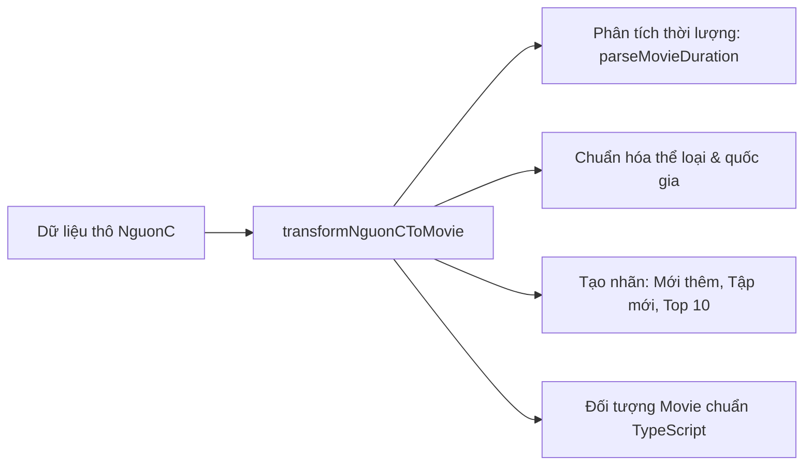

# 📡 02.1 - API NguonC (Danh Sách, Chi Tiết & Tập Phim)

<< [[01.4 - Xac Thuc Nguoi Dung & Phan Quyen (Auth & Session)|<< Trước: Xác Thực & Phân Quyền]] | [[00 - NetLix Brain - Map of Content (MOC)|Trang Chủ MOC]] | [[02.2 - API TMDB (Title Logo & YouTube Trailer)|Tiếp: API TMDB >>]]

---

## 🌐 1. Tổng Quan API Phim NguonC
**Phim NguonC** là nguồn cấp dữ liệu phim trực tuyến miễn phí và phong phú hàng đầu cho các nhà phát triển tại Việt Nam:
- **Base URL**: `https://phim.nguonc.com/api`
- **Định dạng dữ liệu**: JSON
- **Tốc độ phản hồi**: Nhanh, có hỗ trợ nhúng luồng phát trực tiếp (IFrame Embed).

---

## 🔌 2. Các Endpoint Quan Trọng

### 2.1 Phim Mới Cập Nhật
- **URL**: `GET https://phim.nguonc.com/api/films/phim-moi-cap-nhat?page={page}`
- **Công dụng**: Lấy danh sách phim mới nhất vừa được thêm hoặc cập nhật tập mới. Dùng cho hàng đầu trang chủ và trang `/latest`.

### 2.2 Danh Sách Phim Bộ
- **URL**: `GET https://phim.nguonc.com/api/films/danh-sach/phim-bo?page={page}`
- **Công dụng**: Lấy các series dài tập (K-Drama, C-Drama, Âu Mỹ). Dùng cho trang `/series`.

### 2.3 Danh Sách Phim Lẻ
- **URL**: `GET https://phim.nguonc.com/api/films/danh-sach/phim-le?page={page}`
- **Công dụng**: Lấy phim chiếu rạp, phim điện ảnh lẻ. Dùng cho trang `/movies`.

### 2.4 Danh Sách TV Shows & Hoạt Hình
- **TV Shows**: `GET https://phim.nguonc.com/api/films/danh-sach/tv-shows?page={page}`
- **Hoạt hình (Anime)**: `GET https://phim.nguonc.com/api/films/danh-sach/hoat-hinh?page={page}`

### 2.5 Chi Tiết Phim & Danh Sách Tập (`/film/{slug}`)
- **URL**: `GET https://phim.nguonc.com/api/film/{slug}`
- **Công dụng**: Trả về toàn bộ thông tin chi tiết:
  - Diễn viên (`casts`), đạo diễn (`director`), mô tả (`description`).
  - Danh sách server phát phim (`episodes`), trong đó mỗi server chứa các tập:
    - `name`: Tên tập (ví dụ: "1", "2", "Full").
    - `slug`: Slug tập (ví dụ: "tap-1").
    - `embed`: **URL iframe để phát trực tiếp** (ví dụ: `https://embed.nguonc.com/...`).

### 2.6 Tìm Kiếm Phim (`/films/search`)
- **URL**: `GET https://phim.nguonc.com/api/films/search?keyword={keyword}&page={page}`
- **Công dụng**: Tìm kiếm phim theo từ khóa tiếng Việt hoặc tiếng Anh.

---

## ⚙️ 3. Hàm Chuyển Đổi Dữ Liệu: `transformNguonCToMovie`

Nằm tại `services/movieApi.ts`, hàm này chuẩn hóa dữ liệu thô từ NguonC thành đối tượng `Movie` chuẩn của ứng dụng:

### Chi tiết các bước chuẩn hóa:
1. **Phân tích thời lượng thông minh (`parseMovieDuration`)**:
   - Chuyển các định dạng chuỗi phức tạp như *"1 giờ 45 phút"*, *"65 phút/tập"*, *"118 phút"* thành số phút nguyên `durationMinutes` để dễ dàng tính toán tiến trình xem.
2. **Xác định tỷ lệ phù hợp (`matchRate`)**:
   - Sinh ngẫu nhiên từ 94% đến 99% để mô phỏng tỷ lệ phù hợp của Netflix.
3. **Phân loại độ tuổi (`rating`)**:
   - Tự động gắn nhãn `T18`, `T16`, `T13` hoặc `P` dựa vào thể loại phim.
4. **Cấu trúc danh sách Mùa & Tập (`seasonsList`)**:
   - Gom các tập từ `episodes[0].items` thành cấu trúc `Season` để hiển thị trong tab chọn tập của `MovieModal` và `VideoPlayerModal`.

---

## 🛡️ 4. Cơ Chế Dự Phòng (Fallback) Khi API Gián Đoạn
- Hệ thống luôn có tệp `data/moviesData.ts` chứa dữ liệu demo chất lượng cao.
- Nếu API NguonC bị nghẽn mạng hoặc timeout quá thời gian quy định, các hàm fetch trong `movieApi.ts` tự động bắt lỗi (`try...catch`) và trả về danh sách phim từ `moviesData.ts`, giúp website không bao giờ bị trắng trang.
