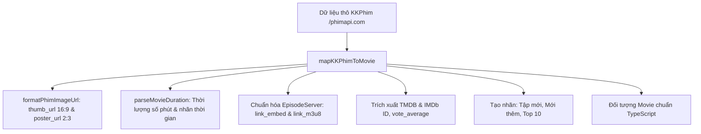
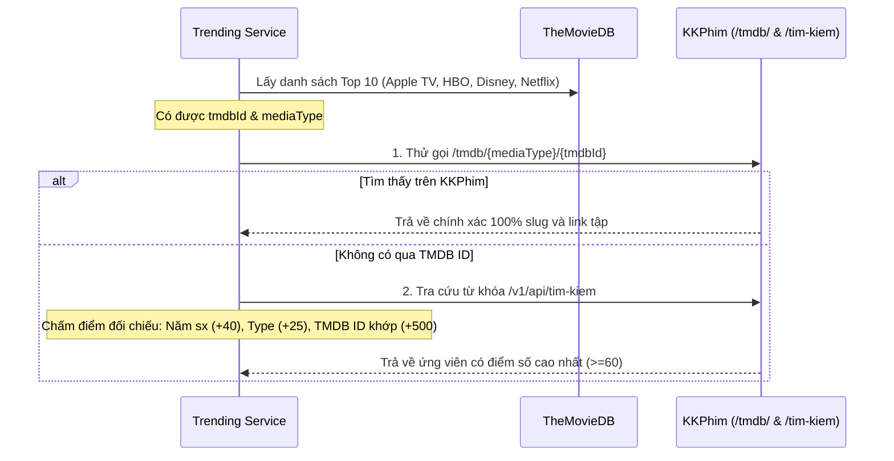

# 📡 02.1 - API KKPhim (`phimapi.com`) - Nền Tảng Dữ Liệu Phim & HLS Streaming

<< [[01.4 - Xac Thuc Nguoi Dung & Phan Quyen (Auth & Session)|<< Trước: Xác Thực & Phân Quyền]] | [[00 - NetLix Brain - Map of Content (MOC)|Trang Chủ MOC]] | [[02.2 - API TMDB (Title Logo & YouTube Trailer)|Tiếp: API TMDB >>]]

---

## 🚀 1. Tổng Quan Kiến Trúc & Lý Do Chuyển Đổi

Hệ thống NetLix đã chính thức chuyển đổi toàn bộ tầng dữ liệu phim từ **NguonC** sang **KKPhim (`phimapi.com`)**. Đây là một bước nâng cấp kiến trúc đột phá, mang lại nhiều lợi thế kỹ thuật vượt trội:

| Tiêu Chí | NguonC cũ | KKPhim (`phimapi.com`) mới |
| :--- | :--- | :--- |
| **Base URL** | `https://phim.nguonc.com/api` | `https://phimapi.com` |
| **Image CDN** | Tự gắn link ngẫu nhiên | `https://phimimg.com` phân định rõ `thumb_url` (16:9 banner) & `poster_url` (2:3 poster) |
| **Định dạng Video** | Chỉ có Iframe Embed (`embed`) | Có cả **Iframe Embed (`link_embed`)** và **Direct HLS stream (`link_m3u8`)** |
| **Định danh TMDB / IMDb** | Không có | **Tích hợp sẵn trực tiếp** trong từng phim (`tmdb.id`, `tmdb.vote_average`, `imdb.id`) |
| **Truy vấn TMDB trực tiếp** | Không hỗ trợ | Có endpoint `GET /tmdb/{type}/{id}` tìm chính xác 100% trong 0ms |
| **Phân trang & Tìm kiếm** | Đơn giản, dễ 429 nếu query nhiều | Hỗ trợ tìm kiếm thông minh (`/v1/api/tim-kiem`), phân trang 24 items/trang |
| **Độ khớp Netflix Top 10** | Dễ sai sót nếu tên gốc là tiếng Nhật/Hàn | Khớp chính xác tuyệt đối qua `tmdb.id` (ví dụ: Doctor X, Slow Horses, Arcane) |

---

## 🔌 2. Danh Sách Endpoints Chi Tiết

### 2.1 Cấu Hình Gốc (Base Configuration)
- **Base URL**: `https://phimapi.com`
- **CDN Hình Ảnh**: `https://phimimg.com`
- **Format**: JSON (UTF-8)
- **Method**: `GET` (Toàn bộ endpoints)

### 2.2 Phim Mới & Trang Chủ
- `GET /v1/api/home`: Dữ liệu phim trang chủ tổng hợp mới nhất hôm nay.
- `GET /v1/api/danh-sach/phim-moi-cap-nhat?page={page}`: Danh sách phim mới cập nhật kèm phân trang (`data.params.pagination`). Dùng cho hàng đầu tiên trang chủ và trang `/latest`.

### 2.3 Danh Sách Theo Loại Hình
- `GET /v1/api/danh-sach/phim-bo?page={page}`: Danh sách series dài tập (Hàn Quốc, Trung Quốc, Âu Mỹ,...). Dùng cho `/series`.
- `GET /v1/api/danh-sach/phim-le?page={page}`: Danh sách phim chiếu rạp, phim lẻ điện ảnh. Dùng cho `/movies`.
- `GET /v1/api/danh-sach/hoat-hinh?page={page}`: Danh sách phim hoạt hình, Anime Nhật Bản, 3D Donghua.
- `GET /v1/api/danh-sach/tv-shows?page={page}`: Danh sách chương trình truyền hình thực tế, gameshow.
- `GET /v1/api/danh-sach/phim-chieu-rap?page={page}`: Phim đang chiếu tại rạp.

### 2.4 Chi Tiết Phim & Danh Sách Tập
- `GET /phim/{slug}`: Chi tiết phim theo slug (Format 1: `{ status: true, movie: {...}, episodes: [...] }`).
- `GET /v1/api/phim/{slug}`: Chi tiết phim format v2 (Format 2: `{ status: "success", data: { item: {...} } }`).
- `GET /tmdb/{type}/{id}`: **Endpoint đột phá** truy vấn trực tiếp phim theo ID của TheMovieDB:
  - `{type}`: `movie` hoặc `tv`
  - `{id}`: TMDB ID (ví dụ: `293167` -> Kong: Skull Island, `46052` -> Doctor X, `94997` -> House of the Dragon).
  - Tự động trả về toàn bộ thông tin phim và tập phim có sẵn trên KKPhim.
- `GET /imdb/title/{id}`: Chi tiết theo IMDb ID (ví dụ: `tt3731562`).

### 2.5 Tìm Kiếm & Bộ Lọc Nâng Cao
- `GET /v1/api/tim-kiem?keyword={keyword}&page={page}&limit=24`:
  Tìm kiếm phim theo từ khóa tiếng Việt hoặc tiếng Anh, hỗ trợ phân trang chuẩn xác và trả về đầy đủ đánh giá TMDB trong kết quả.
- `GET /v1/api/the-loai/{slug}?page={page}`:
  Lọc phim theo thể loại (ví dụ: `hanh-dong`, `tinh-cam`, `hai-huoc`, `vien-tuong`, `kinh-di`, `co-trang`, `hinh-su`,...).
- `GET /v1/api/quoc-gia/{slug}?page={page}`:
  Lọc phim theo quốc gia (ví dụ: `han-quoc`, `au-my`, `nhat-ban`, `viet-nam`, `thai-lan`, `trung-quoc`, `y`,...).

---

## ⚙️ 3. Hàm Chuyển Đổi Dữ Liệu: `mapKKPhimToMovie`

Nằm tại `services/movieApi.ts`, hàm này chuẩn hóa dữ liệu thô từ KKPhim thành đối tượng `Movie` chuẩn của ứng dụng:

### Điểm Cải Tiến Trong Bộ Chuyển Đổi:
1. **Phân Định Ảnh Chuẩn Cinema**:
   - `thumb_url`: Sử dụng làm ảnh nền ngang 16:9 (`backdropUrl`) cho Hero Banner và Video Player.
   - `poster_url`: Sử dụng làm ảnh bìa dọc 2:3 (`posterUrl`) cho các thẻ phim tại Browse Rows.
   - Hàm `formatPhimImageUrl()` tự động thêm tiền tố `https://phimimg.com/` nếu đường dẫn là tương đối.
2. **Khai Thác Đồng Thời 2 Luồng Phát**:
   - `embed`: Gắn link nhúng iframe an toàn (`link_embed`).
   - `m3u8`: Gắn trực tiếp link HLS stream (`link_m3u8`) phục vụ trình phát tùy biến và tối ưu hiệu năng băng thông.
3. **Loại Bỏ Hoàn Toàn Lỗi Lặp Tên "Tập Tập 01"**:
   - Tên tập được làm sạch regex `ep.name.replace(/^Tập\s*/i, '')` trước khi hiển thị trong Season / Episode Selector.
4. **Bảo Lưu Tương Thích Ngược**:
   - Cung cấp alias `export const mapNguonCToMovie = mapKKPhimToMovie;` để tất cả module cũ tiếp tục hoạt động mà không cần refactor hàng loạt.

---

## 🎯 4. Ứng Dụng Trong Khớp Dữ Liệu Netflix Top 10 & Trending Platforms

Tại `services/trendingService.ts`, quy trình khớp phim đã được tối ưu hóa theo 3 tầng bảo vệ:

Nhờ quy trình này:
- Phim như **Bác Sĩ X (Doctor X)** không còn bị hiển thị sai tiêu đề tiếng Nhật mà lấy đúng tên Việt `"Bác Sĩ X Ngoại Khoa: Daimon Michiko"` và khớp đúng mùa tương ứng.
- Các series đình đám như **Slow Horses**, **Severance**, **House of the Dragon**, **Arcane** đều được nhận diện và gắn luồng xem có sẵn ngay lập tức (`isAvailable: true`).
