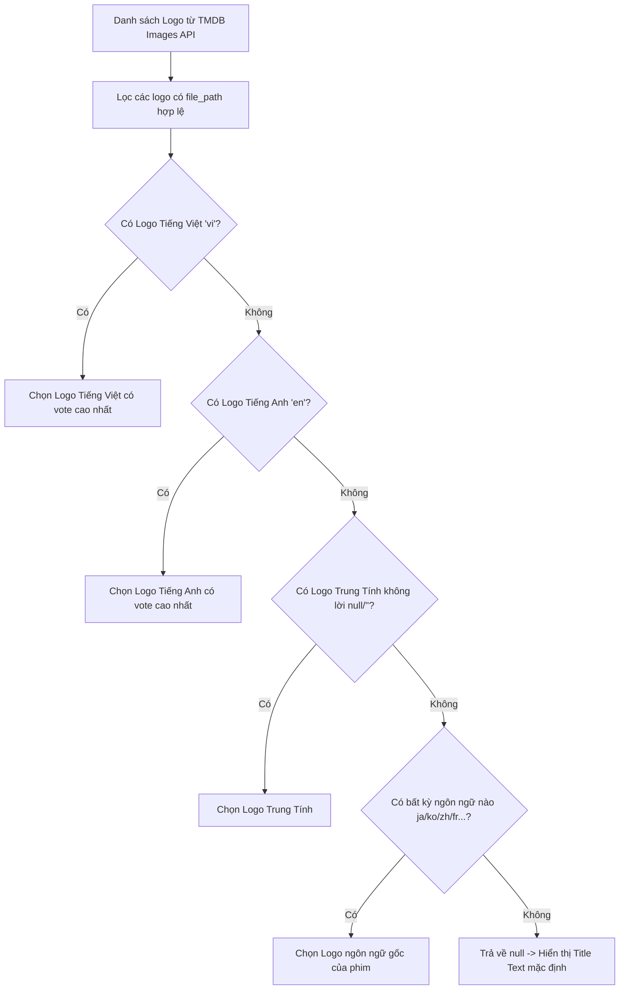

# 🎨 02.2 - API TMDB (Title Logo & YouTube Trailer)

<< [[02.1 - API NguonC (Danh Sach, Chi Tiet & Tap Phim)|<< Trước: API NguonC]] | [[00 - NetLix Brain - Map of Content (MOC)|Trang Chủ MOC]] | [[02.3 - API Routes Noi Bo Next.js|Tiếp: API Routes Nội Bộ >>]]

---

## 🌟 1. Vai Trò Của TMDB Trong NetLix
Mặc dù API NguonC cung cấp đầy đủ thông tin phim và luồng phát, nhưng NguonC không có:
1. **Title Logo (ClearLogo)**: Logo nghệ thuật trong suốt của tên phim (đặc trưng lớn nhất của giao diện Netflix).
2. **Trailer YouTube chất lượng cao**: Video giới thiệu chạy tự động khi hover vào phim hoặc trên Banner đầu trang.

Hệ thống tích hợp **The Movie Database (TMDB)** để bù đắp hoàn hảo 2 yếu tố này.

---

## 🖼️ 2. Hệ Thống Tìm & Chọn Title Logo Nghệ Thuật

### 2.1 Sơ Đồ Chọn Logo Theo Thứ Tự Ưu Tiên Ngôn Ngữ

### 2.2 Quy Trình Phân Giải Logo Trong `services/logoService.ts`
1. **Làm sạch tiêu đề (`cleanMovieTitleForSearch`)**:
   - Loại bỏ các hậu tố tập/mùa như: *(Phần 1)*, *(Season 2)*, *(Vietsub)*, *(2024)*.
   - Giữ nguyên các dấu gạch ngang hoặc dấu hai chấm quan trọng (ví dụ: *Cyberpunk: Edgerunners*, *Spider-Man*).
2. **Tìm kiếm trên TMDB (`/search/multi` hoặc `/search/movie`, `/search/tv`)**:
   - Dùng tên tiếng Việt và tên tiếng Anh (`subTitle`).
   - Ưu tiên ứng viên có cùng năm phát hành (`year`).
3. **Lấy bộ sưu tập ảnh (`/{mediaType}/{id}/images`)**:
   - Đọc mảng `logos`.
4. **Định dạng đường dẫn ảnh (`formatTmdbLogoUrl`)**:
   - Nếu là file `.svg`: Lấy kích thước gốc `https://image.tmdb.org/t/p/original${filePath}` (sắc nét tuyệt đối trên mọi màn hình Retina).
   - Nếu là file `.png`: Lấy bản rộng 500px `https://image.tmdb.org/t/p/w500${filePath}`.

---

## 🎬 3. Hệ Thống Tìm Trailer YouTube (`app/api/trailer/route.ts`)

### 3.1 Quy Trình Tìm Trailer
1. Tìm ID phim trên TMDB qua tên phim và năm sản xuất.
2. Gọi endpoint lấy danh sách video:
   - Phim lẻ: `GET https://api.themoviedb.org/3/movie/{id}/videos`
   - Phim bộ: `GET https://api.themoviedb.org/3/tv/{id}/videos`
3. Lọc các video có `site === 'YouTube'`:
   - Ưu tiên video có `type === 'Trailer'` và `official === true`.
   - Nếu không có Trailer chính thức, lấy video loại `Teaser` hoặc `Clip`.
4. Trả về `youtubeKey` để client phát trực tiếp qua YouTube Iframe API.

---

## ⚡ 4. Bộ Nhớ Đệm Hai Tầng (Two-Tier Caching)

Để tránh bị giới hạn Rate Limit của TMDB và tăng tốc độ hiển thị tức thì cho người dùng:
1. **Server-side In-Memory Cache**:
   - Lưu trữ kết quả trailer và logo trong `Map<string, CacheEntry>`.
   - Các yêu cầu cùng một phim sẽ trả về kết quả trong `0ms` mà không cần gọi lại TMDB.
2. **Client-side In-Memory Cache (`clientLogoCache`)**:
   - Được chia sẻ giữa `HeroBanner`, `HoverPopoutCard` và `MovieModal`.
   - Khi một bộ phim đã tìm được logo ở Card hover, lúc mở `MovieModal` logo sẽ hiện ngay lập tức mà không phải fetch lại.
3. **HTTP Cache Header**:
   - Trả về header `Cache-Control: public, s-maxage=86400, stale-while-revalidate=43200` để các CDN như Vercel Edge Network tự động cache kết quả trong 24 giờ.
