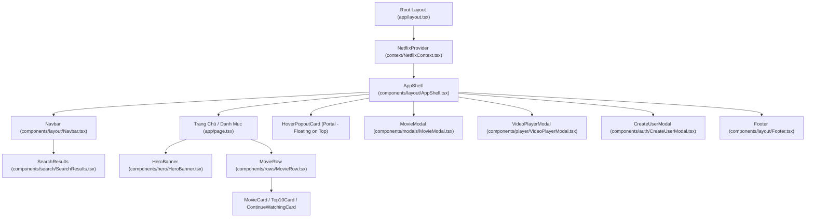

# 🧩 03.1 - Components Architecture & Hierarchy

<< [[02.4 - Firebase Realtime Database & Schema|<< Trước: Firebase Schema]] | [[00 - NetLix Brain - Map of Content (MOC)|Trang Chủ MOC]] | [[03.2 - HeroBanner Component|Tiếp: HeroBanner Component >>]]

---

## 🌳 1. Sơ Đồ Cây Phân Cấp Giao Diện (Component Hierarchy)

---

## 🎨 2. Phân Nhóm Chức Năng Của Các Components

### 2.1 Nhóm Khung Khung Sườn & Điều Hướng (Layout & Navigation)
- `AppShell.tsx`: Vỏ bọc ứng dụng, giữ Navbar luôn dính ở trên, mount các Modal cấp cao và xử lý đệm trang.
- `Navbar.tsx`: Thanh điều hướng mờ kính (glassmorphism), đổi nền đen khi cuộn trang, thanh tìm kiếm live, menu hồ sơ tài khoản.
- `Footer.tsx`: Chân trang chuẩn Netflix với các liên kết chính sách, mã nguồn và bản quyền.

### 2.2 Nhóm Trình Diễn Phim (Display & Showcase)
- `HeroBanner.tsx`: Trải nghiệm mở đầu hoành tráng, video trailer nền mượt mà, Title Logo TMDB với CSS Grid Stacking, các nút tương tác nhanh.
- `MovieRow.tsx`: Hàng phim trượt ngang không thanh cuộn thô, nút bấm trượt trái/phải thông minh với hiệu ứng fade viền.
- `RowSkeleton.tsx`: Hiệu ứng shimmer loading khi dữ liệu đang tải.

### 2.3 Nhóm Thẻ Phim (Cards)
- `MovieCard.tsx`: Thẻ phim chuẩn tỷ lệ 16:9 với nhãn chất lượng, năm phát hành, số tập.
- `Top10Card.tsx`: Thẻ phim Top 10 với số thứ tự nghệ thuật 3D cỡ lớn (`Top10Number.tsx`).
- `ContinueWatchingCard.tsx`: Thẻ phim đang xem dở với thanh tiến trình đỏ và nút xem tiếp 1 chạm.
- `HoverPopoutCard.tsx`: Card xem trước động phóng to khi hover chuột, tự động phát trailer kèm âm thanh.

### 2.4 Nhóm Hộp Thoại & Trình Phát (Modals & Player)
- `MovieModal.tsx`: Bảng thông tin toàn diện về phim, xem danh sách tập theo server, danh sách phim tương tự.
- `VideoPlayerModal.tsx`: Trình phát phim chuẩn rạp, hỗ trợ xoay màn hình, tự động ẩn thanh điều khiển, đổi tập phim siêu tốc.
- `CreateUserModal.tsx`: Hộp thoại quản trị tài khoản dành cho Admin.
