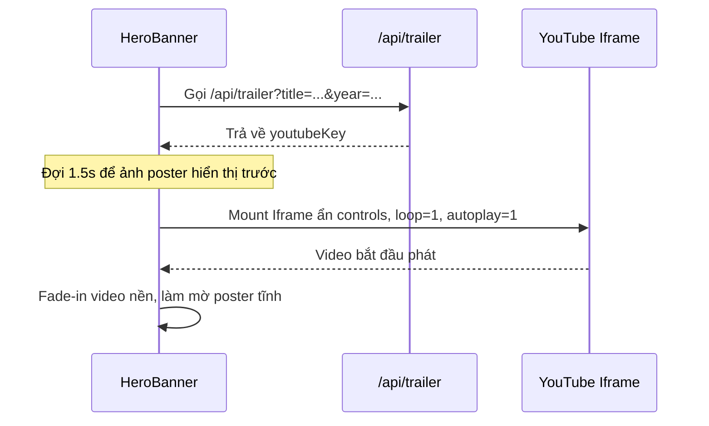

# 🌟 03.2 - HeroBanner Component

<< [[03.1 - Components Architecture & Hierarchy|<< Trước: Kiến Trúc Components]] | [[00 - NetLix Brain - Map of Content (MOC)|Trang Chủ MOC]] | [[03.3 - HoverPopoutCard Component|Tiếp: HoverPopoutCard >>]]

---

## 📌 1. Vai Trò & Điểm Nổi Bật Của HeroBanner
Nằm tại `components/hero/HeroBanner.tsx`, **HeroBanner** là bộ mặt của toàn bộ ứng dụng NetLix:
1. **Video Trailer Nền Tự Động Chạy**: Tự động lấy trailer từ YouTube qua TMDB và phát nền mượt mà sau 1.5 giây.
2. **Kỹ Thuật CSS Grid Stacking Cho Title Logo**: Loại bỏ hoàn toàn hiện tượng giật giật (layout shift / flicker) khi chuyển đổi giữa Text Title và Logo TMDB.
3. **Đồng Bộ Âm Thanh Hoàn Hảo**: Tích hợp với `isMuted` từ `NetflixContext`.
4. **Vignette Chuyển Tiếp Đẳng Cấp**: Lớp gradient chuyển mờ dần từ video sang nền đen của danh sách phim bên dưới mà không có đường cắt ngang.

---

## 📐 2. Kỹ Thuật Chống Giật Layout: CSS Grid Stacking

### 2.1 Vấn Đề Thực Tế
Trước đây, khi phim mới load, hệ thống hiển thị tên phim dạng Text (thẻ `<h1>`). Khi API TMDB trả về Logo sau 500ms, Text biến mất và thẻ `` xuất hiện. Điều này làm:
- Chiều cao khối tiêu đề thay đổi đột ngột.
- Toàn bộ mô tả và các nút "Phát", "Thông tin khác" bị nhảy vọt lên hoặc xuống (Layout Shift - CLS kém).
- Tạo cảm giác "giật một cái bụp" gây khó chịu thị giác.

### 2.2 Giải Pháp Triệt Để Bằng CSS Grid Stacking
Thay vì dùng `if/else` để render một trong hai, ta đặt cả Text Title và Logo Image vào cùng một ô lưới CSS Grid:

```tsx
<div style={{ display: 'grid', gridTemplateColumns: '1fr', gridTemplateRows: '1fr' }} className="items-end">
  {/* Layer 1: Text Title (Luôn giữ khung kích thước chuẩn) */}
  <h1
    style={{ gridArea: '1 / 1 / 2 / 2' }}
    className={`transition-opacity duration-700 ease-in-out font-black text-3xl sm:text-5xl md:text-6xl uppercase tracking-wider text-white drop-shadow-2xl ${
      logoLoaded && logoUrl ? 'opacity-0 pointer-events-none' : 'opacity-100'
    }`}
  >
    {movie.title}
  </h1>

  {/* Layer 2: Title Logo Image (Nằm đè cùng vị trí với Text) */}
  {logoUrl && (
    <div
      style={{ gridArea: '1 / 1 / 2 / 2' }}
      className={`transition-opacity duration-700 ease-in-out flex items-end ${
        logoLoaded ? 'opacity-100' : 'opacity-0 pointer-events-none'
      }`}
    >
       setLogoLoaded(true)}
        className="max-h-24 sm:max-h-32 md:max-h-40 max-w-[80%] sm:max-w-[70%] object-contain filter drop-shadow-[0_8px_20px_rgba(0,0,0,0.9)]"
      />
    </div>
  )}
</div>
```

**Ưu điểm**:
- Cả hai phần tử cùng chiếm một tọa độ lưới (`1 / 1 / 2 / 2`).
- Kích thước khối được giữ ổn định 100%.
- Hiệu ứng `transition-opacity duration-700` hòa tan Text và làm hiện Logo một cách vô cùng êm ái như phim điện ảnh.

---

## 🎬 3. Tích Hợp Video Trailer Nền



- **Xử lý âm thanh**: Video khởi tạo với cờ `mute=1` hoặc `mute=0` dựa trên giá trị `isMuted` của người dùng.
- **Nút bật/tắt âm thanh**: Nhấp vào nút Volume ở góc phải sẽ gọi `toggleMute()` và gửi thông điệp `postMessage` tới iframe YouTube để lập tức unmute/mute mà không cần tải lại video.
