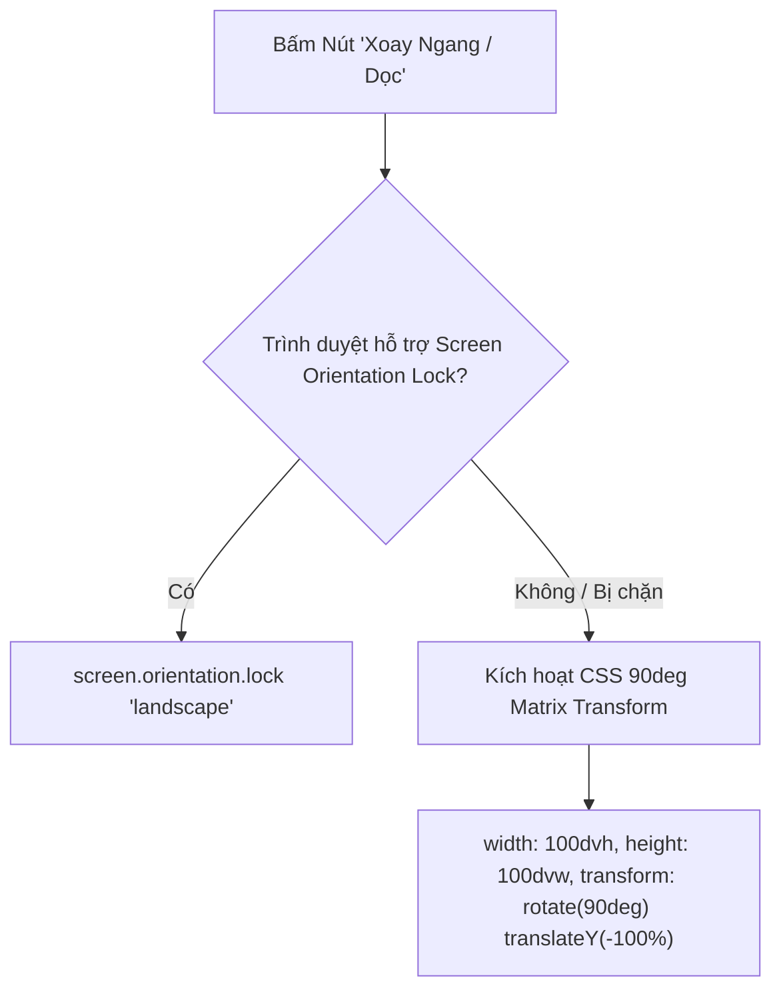

# 🎥 03.4 - VideoPlayerModal Component

<< [[03.3 - HoverPopoutCard Component|<< Trước: HoverPopoutCard]] | [[00 - NetLix Brain - Map of Content (MOC)|Trang Chủ MOC]] | [[03.5 - MovieModal Component|Tiếp: MovieModal >>]]

---

## 📽️ 1. Giới Thiệu VideoPlayerModal
Nằm tại `components/player/VideoPlayerModal.tsx`, đây là thành phần cốt lõi mang lại trải nghiệm xem phim rạp đỉnh cao:
- Chiếm trọn màn hình (`fixed inset-0 z-[60] bg-black`).
- Hỗ trợ cả **Stream IFrame từ API NguonC** và **HTML5 Video Player** (cho trailer hoặc video demo).
- Tích hợp điều khiển thông minh tự động ẩn sau 3.5 giây không tương tác.
- Tối ưu hóa đặc biệt cho thiết bị di động (Mobile Gestures & Xoay màn hình).

---

## 📱 2. Tối Ưu Hóa Trải Nghiệm Trên Mobile

### 2.1 Cơ Chế Hiện/Ẩn Điều Khiển Thông Minh (3.5s Auto-Hide)
- Khi bắt đầu mở phim hoặc khi người dùng chạm vào màn hình / rê chuột, thanh điều khiển phía trên (Header Bar) sẽ hiện ra với hiệu ứng fade-in.
- Sau **3.5 giây** không có tương tác, toàn bộ các nút điều khiển sẽ tự động mờ dần và ẩn hoàn toàn (`opacity-0 pointer-events-none`).
- **Không có nút cố định gây che nội dung phim**: Toàn bộ không gian màn hình được trả lại 100% cho phim.

### 2.2 Vùng Chạm Kích Hoạt (Top Gesture Zone & Window Blur)
Vì stream iframe của NguonC là một trang cross-origin, các thao tác chạm thông thường vào lòng iframe sẽ bị iframe nuốt chửng mà không gửi sự kiện lên trang cha:
1. **Top Gesture Zone**:
   - Hệ thống đặt một dải cảm ứng trong suốt ở 96px trên cùng (`h-20 sm:h-24 absolute top-0 z-20 cursor-pointer`).
   - Vì các trình phát video (NguonC, JWPlayer, v.v.) luôn đặt thanh tua và nút play ở dưới đáy, vùng 96px phía trên không bao giờ có nút của video player.
   - Khi người dùng trên điện thoại chạm vào nửa trên màn hình -> Ngay lập tức kích hoạt `resetControlsTimer()` và làm thanh điều khiển hiện lên!
2. **Lắng nghe sự kiện Window Blur**:
   - Khi người dùng nhấp hoặc chạm vào bất kỳ đâu trong iframe, trình duyệt sẽ chuyển focus vào iframe và kích hoạt sự kiện `window.onblur`.
   - Lắng nghe `window.addEventListener('blur', resetControlsTimer)` giúp phát hiện việc người dùng tương tác với video để đánh thức thanh điều khiển.

---

## 🔄 3. Khóa & Xoay Màn Hình Di Động (Screen Orientation)

Nhiều người dùng điện thoại có thói quen khóa xoay màn hình ở chế độ dọc (Portrait Lock). Khi xem phim, họ phải mở Control Center để tắt khóa xoay rất bất tiện.

NetLix trang bị giải pháp xoay 2 tầng trong hàm `toggleRotate()`:



- **Tầng 1 (Native Lock)**: Gọi `screen.orientation.lock('landscape')` để xoay giao diện sang ngang chuẩn hệ thống.
- **Tầng 2 (CSS Fallback)**: Nếu trình duyệt (như Safari trên iOS) chặn Native Lock, hệ thống tự động áp dụng ma trận biến đổi CSS 90 độ phần cứng (`transform: rotate(90deg) translateY(-100%)`), biến toàn bộ video thành màn hình ngang trọn vẹn ngay trong tư thế cầm điện thoại dọc!
- **Tự động nhận diện khi xoay thật**: Lắng nghe sự kiện `orientationchange` và `resize`. Nếu người dùng xoay ngang điện thoại thật, hệ thống tự động tắt chế độ xoay CSS giả lập.

---

## 🎛️ 4. Thanh Điều Khiển Hợp Nhất (Header Bar)

Thanh Header được bố trí cân đối và sang trọng:
1. **Bên Trái**:
   - Nút **Thoát** (ArrowLeft + nhãn "Thoát" mờ kính cao cấp).
   - **Tên phim** & **Tập đang phát** (Ví dụ: *"ĐỪNG BƯỚC BÊN NHAU - Tập 6"*).
2. **Bên Phải**:
   - Nút **Xoay màn hình** (*"Xoay ngang"* hoặc *"Xoay dọc"* với icon `RotateCw`).
   - Nút **Chọn tập** (Popover hiển thị lưới tập phim 1, 2, 3... - tự động giữ thanh điều khiển không bị ẩn trong lúc người dùng đang chọn tập).
   - Nút **Toàn màn hình** (Fullscreen).

---

## ⏳ 5. Đồng Bộ Tiến Trình Định Kỳ (Periodic Tracking)
Trong `useEffect`, cứ mỗi **5 giây**, hệ thống tự động tính toán thời gian xem hiện tại và gọi:
```typescript
updateWatchProgress(
  playingMovie,
  currentTime,
  duration,
  currentEpisodeTitle,
  currentEpisodeEmbed
);
```
Tiến trình này được đẩy về API `/api/user/progress` để đồng bộ lên Firebase Realtime Database.
