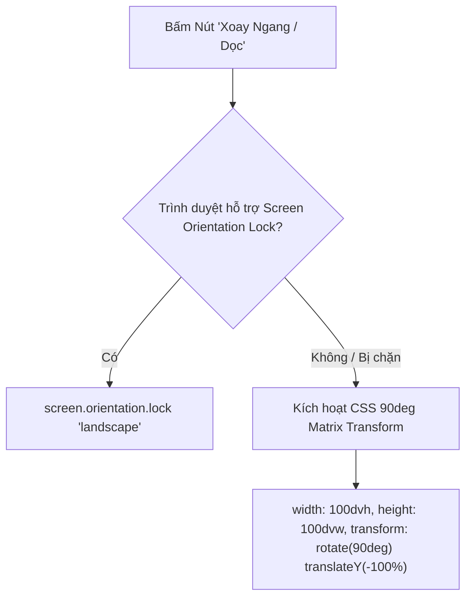

# 🎥 03.4 - VideoPlayerModal Component

<< [[03.3 - HoverPopoutCard Component|<< Trước: HoverPopoutCard]] | [[00 - NetLix Brain - Map of Content (MOC)|Trang Chủ MOC]] | [[03.5 - MovieModal Component|Tiếp: MovieModal >>]]

---

## 📽️ 1. Giới Thiệu VideoPlayerModal
Nằm tại `components/player/VideoPlayerModal.tsx`, đây là thành phần cốt lõi mang lại trải nghiệm xem phim rạp đỉnh cao:
- Chiếm trọn màn hình (`fixed inset-0 z-[60] bg-black`).
- Hỗ trợ kiến trúc **Dual-Engine Player: Native HLS.js Player (Stream trực tiếp `.m3u8`)** làm trình phát chính và **Iframe Embed (`link_embed`)** làm dự phòng.
- Nhờ HLS.js, ứng dụng làm chủ 100% thẻ `<video>` HTML5: tua tới/lùi chính xác từng giây, bắt sự kiện `onTimeUpdate` thực, điều khiển âm lượng, toàn màn hình và tự chuyển tập kế tiếp khi hết phim.
- Khôi phục chính xác tiến trình dừng lại lần trước ("Tiếp tục xem"), tự động nhảy đến đúng thời điểm (ví dụ 09:00 / 12%) thay vì bị kẹt ở `00:00`.
- Hiển thị Toast thông báo trạng thái tiếp tục xem kèm nút bấm nhanh **[Xem lại từ đầu]**.
- Tích hợp điều khiển thông minh tự động ẩn sau 3.5 giây không tương tác.
- Tối ưu hóa đặc biệt cho thiết bị di động (Mobile Gestures & Xoay màn hình).

---

## ⚡ 2. Kiến Trúc Dual-Engine: HLS.js & Iframe Fallback

Trước đây, khi nhúng trình phát qua `iframe` cross-origin (`player.phimapi.com`), trang chủ bị cô lập bởi chính sách Same-Origin Policy, không thể can thiệp vào `currentTime` của video. 

NetLix đã nâng cấp lên cơ chế phát trực tiếp:
1. **Kiểm tra luồng HLS (`.m3u8`)**:
   - KKPhim cung cấp URL `link_m3u8` với header `Access-Control-Allow-Origin: *`.
   - Sử dụng thư viện `hls.js` truyền luồng trực tiếp vào thẻ `<video ref={videoRef}>`.
   - Khi sự kiện `Hls.Events.MANIFEST_PARSED` hoặc `loadedmetadata` kích hoạt:
     ```typescript
     if (sessionSecondsRef.current > 5) {
       video.currentTime = sessionSecondsRef.current;
       setCurrentTime(sessionSecondsRef.current);
     }
     ```
2. **Khôi phục tiến trình ("Tiếp tục xem")**:
   - Khi mở phim từ Modal hay Hàng tiếp tục xem, hệ thống truy vấn `getEpisodeProgress(movieKey, currentEp)` hoặc `getWatchProgress(movieKey)`.
   - Đặt `sessionSecondsRef.current = initialSecs`.
   - Video tự động tua tới đúng giây đó và bắt đầu phát mượt mà.
   - Xuất hiện Floating Toast sang trọng: `🔴 Đang phát: Tập 04 • Tiếp tục từ 09:00 [Xem lại từ đầu]`.
3. **Chế độ Iframe Dự Phòng (Fallback Switcher)**:
   - Nếu gặp lỗi mạng fatal không thể khôi phục, hệ thống tự động fallback sang `iframe`.
   - Đồng thời trên Header Bar có nút bấm chuyển đổi giữa hai chế độ nếu người dùng muốn.

---

## 📱 3. Tối Ưu Hóa Trải Nghiệm Trên Mobile

### 3.1 Cơ Chế Hiện/Ẩn Điều Khiển Thông Minh (3.5s Auto-Hide)
- Khi bắt đầu mở phim hoặc khi người dùng chạm vào màn hình / rê chuột, thanh điều khiển phía trên (Header Bar) và thanh Scrubber phía dưới sẽ hiện ra với hiệu ứng fade-in.
- Sau **3.5 giây** không có tương tác, toàn bộ các nút điều khiển sẽ tự động mờ dần và ẩn hoàn toàn (`opacity-0 pointer-events-none`).
- **Không có nút cố định gây che nội dung phim**: Toàn bộ không gian màn hình được trả lại 100% cho phim.

### 3.2 Vùng Chạm Kích Hoạt (Top Gesture Zone & Window Blur)
- Hệ thống đặt một dải cảm ứng trong suốt ở 96px trên cùng (`h-24 absolute top-0 z-20 cursor-pointer`).
- Khi người dùng trên điện thoại chạm vào nửa trên màn hình -> Ngay lập tức kích hoạt `resetControlsTimer()` và làm thanh điều khiển hiện lên!

---

## 🔄 4. Khóa & Xoay Màn Hình Di Động (Screen Orientation)

Nhiều người dùng điện thoại có thói quen khóa xoay màn hình ở chế độ dọc (Portrait Lock). Khi xem phim, họ phải mở Control Center để tắt khóa xoay rất bất tiện.

NetLix trang bị giải pháp xoay 2 tầng trong hàm `toggleRotate()`:



- **Tầng 1 (Native Lock)**: Gọi `screen.orientation.lock('landscape')` để xoay giao diện sang ngang chuẩn hệ thống.
- **Tầng 2 (CSS Fallback)**: Nếu trình duyệt (như Safari trên iOS) chặn Native Lock, hệ thống tự động áp dụng ma trận biến đổi CSS 90 độ phần cứng (`transform: rotate(90deg) translateY(-100%)`), biến toàn bộ video thành màn hình ngang trọn vẹn ngay trong tư thế cầm điện thoại dọc!
- **Tự động nhận diện khi xoay thật**: Lắng nghe sự kiện `orientationchange` và `resize`. Nếu người dùng xoay ngang điện thoại thật, hệ thống tự động tắt chế độ xoay CSS giả lập.

---

## 🎛️ 5. Thanh Điều Khiển Hợp Nhất (Header Bar & Bottom Scrubber)

1. **Thanh Header Phía Trên**:
   - Nút **Thoát** (ArrowLeft + nhãn "Thoát" mờ kính cao cấp - tự động lưu lại tiến trình xem trước khi đóng).
   - **Tên phim** & **Tập đang phát** (Chuẩn hóa qua `formatEpisodeTitle`: hiển thị đẹp mắt như *"100 NGÀY LỪA DỐI • Tập 04"*, triệt tiêu hoàn toàn lỗi lặp *"Tập Tập 04"*).
   - Nút **Chuyển chế độ phát** (HLS / Dự phòng Iframe).
   - Nút **Xoay màn hình** (*"Xoay ngang"* hoặc *"Xoay dọc"* với icon `RotateCw`).
   - Nút **Chọn tập** (Popover lưới các tập - tự động giữ thanh điều khiển không bị ẩn trong lúc chọn tập).
   - Nút **Toàn màn hình** (Fullscreen).

2. **Thanh Scrubber & Nút Chức Năng Phía Dưới**:
   - Thanh trượt dòng thời gian (Scrubber) hiển thị phút/giây hiện tại và thời gian còn lại.
   - Play / Pause (phím tắt Space).
   - Tua lại 10s / Tua tới 10s (phím tắt Mũi tên Trái / Phải).
   - Thanh trượt âm lượng & Bật/Tắt tiếng (phím tắt M).
   - Huy hiệu "Tiếng Việt • Full HD".

---

## ⏳ 6. Đồng Bộ Tiến Trình Định Kỳ (Periodic Tracking)
Trong `useEffect`, cứ mỗi **4 giây** (hoặc khi người dùng nhấn "Thoát" / dừng xem), hệ thống ghi nhận chính xác `currentTime` và `duration` thực tế từ `videoRef.current`:
```typescript
updateWatchProgress(
  playingMovie,
  currentTime,
  duration,
  currentEpisodeTitle,
  activeEmbed,
  resolvedM3u8
);
```
Tiến trình này lập tức được ghi vào `localStorage` theo từng người dùng và đồng bộ ngầm lên Firebase Realtime Database qua API `/api/user/progress`.

---

## 🛡️ 7. Kiến Trúc Phân Lớp Pointer Events & Vùng Chạm Tương Tác

Để ngăn chặn hiện tượng xung đột CSS làm tê liệt các nút bấm trên giao diện Player (ERR-12):
1. **Lớp bọc điều khiển (Overlay Container)**:
   - Khai báo tĩnh `pointer-events-none z-30`.
   - Không khai báo đồng thời `pointer-events-none` và `pointer-events-auto` trên cùng một thẻ để tránh luật Cascade trong CSS Tailwind.
2. **Thanh Header & Thanh Scrubber**:
   - Được kích hoạt `pointer-events-auto` khi `showControls === true`.
   - Tất cả các nút bấm con, thanh kéo thời gian `<input type="range">`, thanh âm lượng đều kích hoạt `e.stopPropagation()` để sự kiện nhấp chuột không bị lọt ra ngoài.
3. **Vùng Chạm Trung Tâm (Dedicated Middle Click Zone)**:
   - Một thẻ `<div>` linh hoạt (`flex-1 w-full pointer-events-auto`) nằm giữa thanh tiêu đề và thanh điều khiển dưới.
   - Nhấp vào vùng này sẽ gọi `togglePlay()` và khởi động lại bộ đếm ẩn thanh điều khiển 3.5 giây.
   - Khi tạm dừng, biểu tượng Play mờ kính xuất hiện ở trung tâm để người dùng dễ dàng nhận biết.
4. **Thẻ `<video>` HTML5 Thuần Túy**:
   - Đã gỡ bỏ hoàn toàn `onClick={togglePlay}` trực tiếp trên thẻ video, bảo đảm mọi tương tác chuột đều được quản lý chính xác qua hệ thống UI Overlay.

---

## ⏭️ 8. Tính Năng Chuyển Tập Tiếp Theo (Next Episode Card) Chuẩn Netflix

### 8.1 Bối Cảnh & Quyết Định Thiết Kế Nghiệp Vụ
- **Loại bỏ Skip Intro mạo hiểm**: Nhận diện intro/outro bằng heuristic hoặc hành vi người dùng rất dễ cắt lẹm vào nội dung phim hoặc đoạn mở đầu cao trào. Do đó, hệ thống tập trung hoàn thiện tính năng **Chuyển tập tiếp theo (Next Episode)** chuẩn điện ảnh Netflix dành cho các phim bộ (`series` hoặc các phim có nhiều hơn 1 tập trong server).
- **Trải nghiệm tôn trọng người xem**:
  - **Không tự động đếm ngược 10s ép chuyển tập**: Video vẫn phát bình thường đến hết để người dùng có thể thưởng thức trọn vẹn nhạc phim outro, danh đề (rolling credits) hoặc cảnh sau danh đề (after-credits).
  - **Chỉ cung cấp nút bấm duy nhất [Phát ngay]**: Trao toàn quyền quyết định cho người dùng.

### 8.2 Thuật Toán Kiểm Soát & Bảo Vệ Tập Mới Nhất (Strict Episode Safeguard)
Hệ thống sử dụng `useMemo` tính toán `nextEpisode` từ danh sách tập của server hiện tại (`currentServer.items`):
```typescript
const nextEpisode = useMemo(() => {
  if (!currentServer?.items || currentServer.items.length <= 1) return null;
  const currentTitle = formatEpisodeTitle(
    currentEpisodeTitle || playingMovie?.currentEpisode || ''
  );
  const currentIndex = currentServer.items.findIndex(
    (ep) =>
      (activeEmbed && ep.embed === activeEmbed) ||
      (resolvedM3u8 && ep.m3u8 === resolvedM3u8) ||
      formatEpisodeTitle(ep.name) === currentTitle
  );
  // Chỉ trả về nếu thực sự có tập kế tiếp
  if (currentIndex >= 0 && currentIndex + 1 < currentServer.items.length) {
    return currentServer.items[currentIndex + 1];
  }
  return null;
}, [currentServer, activeEmbed, resolvedM3u8, currentEpisodeTitle, playingMovie?.currentEpisode, formatEpisodeTitle]);
```
- **Bảo vệ tập mới nhất**: Nếu người dùng đang xem tập mới nhất vừa ra mắt (hoặc tập cuối của bộ phim), `currentIndex + 1 < currentServer.items.length` sẽ trả về `false` $\rightarrow$ `nextEpisode` luôn là `null`. Card sẽ tuyệt đối **KHÔNG BAO GIỜ HIỂN THỊ**.

### 8.3 Cơ Chế Kích Hoạt 90s Cuối Phim & Tự Động Ẩn Sau 5s (5s Auto-Hide)
1. **Kích hoạt ở 90 giây cuối phim**:
   - Khi `handleTimeUpdate` ghi nhận thời gian còn lại $\le 90$ giây (`duration - currentTime <= 90 && duration > 120`), card Tập tiếp theo sẽ trượt nhẹ và mờ sáng dần (`opacity-100 translate-y-0 scale-100`).
2. **Tự động ẩn sau 5 giây (Auto-Fadeout)**:
   - Một bộ đếm thời gian 5 giây được kích hoạt. Nếu người xem không bấm, sau 5 giây card sẽ nhẹ nhàng thu nhỏ và mờ dần vào hư không (`opacity-0 translate-y-4 scale-95 pointer-events-none`).
3. **Hiện lại khi di chuột hoặc chạm màn hình (Interaction Revival)**:
   - Trong khoảng 90s cuối, bất cứ khi nào người dùng di chuột (`mousemove`), chạm màn hình di động (`touchstart`), hoặc nhấn chuột (`pointerdown`), card sẽ lập tức hiện lại mượt mà và thiết lập lại bộ đếm 5 giây mới.
4. **Hồi phục khi tua lại (Rewind Recovery)**:
   - Nếu người dùng tua lùi video về trước mốc 90s cuối, cờ `hasTriggeredNearEndRef` sẽ được xóa và card ẩn đi. Khi video phát tới mốc 90s một lần nữa, card sẽ được kích hoạt lại đúng chuẩn.
5. **Vị trí thông minh thích ứng (Adaptive Positioning)**:
   - Khi thanh Scrubber Controls đang hiện: Card tự động neo ở `bottom-28 sm:bottom-32` để không che khuất dòng thời gian và các nút điều khiển.
   - Khi Scrubber Controls tự ẩn: Card trượt nhẹ xuống `bottom-6 sm:bottom-8` tạo góc nhìn thoáng đãng tối đa.

### 8.4 Thiết Kế Giao Diện Kính Lỏng (Liquid Glass UI & Refraction)
- **Khắc phục che khuất nội dung phim**: Ban đầu card sử dụng nền tối (`bg-zinc-950/90`) và nút đục đặc (`bg-white`), tạo thành một khối đen đặc che mất phụ đề (subtitles) và phần vai diễn viên ở góc màn hình.
- **Kiến trúc Kính Lỏng (Liquid Glass)**:
  - **Thân card siêu trong suốt (Translucent Optical Blur)**: `bg-black/30 hover:bg-black/40 backdrop-blur-2xl border border-white/20 hover:border-white/35`. Video bên dưới được khúc xạ mềm mại, cho phép người dùng nhìn xuyên qua toàn bộ nội dung cảnh quay và phụ đề.
  - **Viền khúc xạ ánh sáng (Liquid Rim Specularity)**: `shadow-[inset_0_1px_1px_rgba(255,255,255,0.4),0_16px_40px_rgba(0,0,0,0.5)]` tạo cảm giác bề mặt kính cong nổi bắt sáng như pha lê.
  - **Vầng quang khúc xạ đa sắc (Ambient Liquid Flares)**: Hai luồng sáng khúc xạ chìm bên trong card: luồng sáng trắng phản chiếu góc trên trái (`from-white/20 blur-2xl`) và luồng đỏ Netflix tinh tế góc dưới phải (`bg-red-600/20 blur-2xl`).
  - **Nút "Phát ngay" dạng Liquid Glass Pill**: Sử dụng `bg-white/20 hover:bg-white/30 backdrop-blur-xl border border-white/35` kèm hiệu ứng vệt sáng lỏng quét ngang (`liquid shimmer sweep effect`) khi rê chuột, đồng bộ hoàn hảo với ngôn ngữ kính lỏng.
  - **Bảo toàn độ tương phản**: Tiêu đề và thông tin tập phim được bổ sung `drop-shadow-[0_2px_4px_rgba(0,0,0,0.9)]` giúp chữ luôn nổi bật và đọc rõ trên mọi khung hình phim (dù là cảnh quay tối hay sáng chói).


