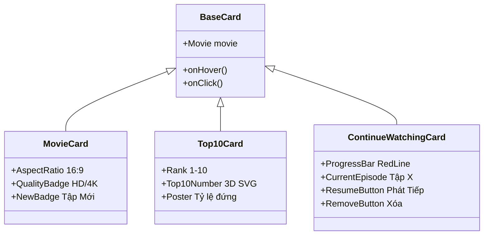

# 🎞️ 03.6 - MovieRow & Cards Components

<< [[03.5 - MovieModal Component|<< Trước: MovieModal]] | [[00 - NetLix Brain - Map of Content (MOC)|Trang Chủ MOC]] | [[03.7 - Navbar & Search Components|Tiếp: Navbar & Search >>]]

---

## 🎠 1. Hàng Phim Trượt Ngang (`MovieRow.tsx`)
Hàng phim là khối xây dựng cơ bản của trang chủ Netflix:
- **Cuộn ngang mượt mà (Smooth Horizontal Scroll)**:
  - Sử dụng CSS `overflow-x: scroll` kết hợp `scrollbar-width: none` để ẩn hoàn toàn thanh cuộn thô của trình duyệt.
  - Các nút mũi tên trái/phải tính toán chiều rộng của khung nhìn (`rowRef.current.clientWidth * 0.75`) để trượt một khoảng vừa phải khi nhấp.
- **Che mờ viền (Edge Vignette Gradients)**:
  - Khi cuộn, hai bên mép có hiệu ứng gradient đen mờ dần để tạo cảm giác hàng phim trải dài vô tận.

---

## 🃏 2. Hệ Thống Các Loại Thẻ Phim (Card Types)

### 2.1 `MovieCard.tsx` (Thẻ Phim Chuẩn Dạng Ngang - Landscape)
- **Tỷ lệ khung hình 16:9 (ngang)** chuẩn điện ảnh: toàn bộ các hàng phim thông thường (quốc gia, thể loại, vũ trụ điện ảnh, nền tảng) đều sử dụng dạng ngang để đạt độ đồng bộ tuyệt đối giống Netflix.
- **Huy hiệu thông minh (Smart Badges)**:
  - *"Tập mới"*: Tự động hiển thị khi phim bộ có tập mới ra mắt.
  - *"Mới thêm"*: Chỉ hiển thị cho các phim mới cập nhật gần đây (trong vòng 10 ngày). Các phim cũ hoàn toàn bị ẩn tag để tránh nhiễu thông tin.
  - *"Sắp chiếu / Chưa có sẵn"*: Dựa trên việc kiểm tra thực tế số lượng tập phát (`episodes.length === 0`) từ NguonC.
  - *"Top Platform Badge"*: Đối với phim thuộc Top của các nền tảng sẽ có logo thương hiệu riêng: `TOP 10` (Netflix), `tv TOP 10`, `HBO TOP 10`.

### 2.2 `Top10Card.tsx` (Thẻ Phim Top 10 Dạng Dọc - Portrait)
- **Độc quyền cho các hàng Top 10**: Chỉ duy nhất các hàng Top 10 (ví dụ: *Top 10 Series Netflix tại VN*, *Top 10 Phim lẻ Netflix tại VN*, *Top 10 Apple TV*, *Top 10 HBO*) mới sử dụng thẻ dạng dọc tỉ lệ **2:3**.
- **Đồng bộ đa nền tảng**: Toàn bộ các bảng xếp hạng Top 10 của các nền tảng đều sử dụng chung component `Top10Card` để đảm bảo giao diện trực quan và đồng nhất chuẩn Netflix.
- **Cấu trúc thị giác ấn tượng**:
  - **Chữ số 3D nghệ thuật (`Top10Number.tsx`)**: Đặt ở nửa bên trái mỗi thẻ, từ số 1 đến số 10 cỡ lớn, vẽ bằng vector SVG đa tầng có viền xám bạc và đổ bóng nổi khối đậm chất Netflix.
  - **Poster dọc tỷ lệ 2:3**: Nằm chồng một phần lên chữ số ở nửa bên phải, hiển thị poster chất lượng cao.
  - **Huy hiệu nền tảng tích hợp**: Ở góc trên của poster hiển thị huy hiệu `TOP 10` kèm logo platform tương ứng (Netflix đỏ, Apple TV trắng, HBO tím).
- **Phân bổ ngẫu nhiên & Thứ tự ưu tiên**:
  - Các trụ cột nền tảng (Netflix, Apple TV, HBO) được phân bố tách riêng, bố trí ngẫu nhiên xen kẽ giữa các mục khác trên giao diện để tạo trải nghiệm khám phá tự nhiên.
  - Hàng Top 10 của Netflix luôn được ưu tiên bố trí ở vị trí cao nhất trên trang chủ so với các nền tảng còn lại.

### 2.3 `ContinueWatchingCard.tsx` (Thẻ Tiếp Tục Xem)
- Dành riêng cho hàng "Tiếp tục xem của bạn".
- Có thanh tiến trình màu đỏ ở cạnh đáy thẻ phản ánh chính xác % thời gian đã xem.
- Nút tròn Play ở trung tâm giúp tiếp tục xem ngay mà không cần qua bước trung gian.
- Nút dấu `X` ở góc phải cho phép xóa phim khỏi lịch sử xem. Hỗ trợ prop `fillWidth` khi đặt trong trang `/my-list`.

---

## 🛡️ 3. Cơ Chế Chống Lỗi Ảnh Bìa Toàn Diện (Image Fallback & Error Resilience)

Mọi thẻ phim trên giao diện đều được bọc lớp phòng thủ chống vỡ hình 2 lớp:
1. **Placeholder Định Dạng Chuẩn**:
   - Thẻ ngang (`MovieCard`, `ContinueWatchingCard`, `HoverPopoutCard`): Sử dụng `/images/backdrop-placeholder.svg` (tỉ lệ 16:9).
   - Thẻ dọc (`Top10Card`, `MovieCard` portrait): Sử dụng `/images/poster-placeholder.svg` (tỉ lệ 2:3).
2. **Xử lý `onError` tại Runtime**:
   - Khi mạng chập chờn hoặc link ảnh CDN trả về 404, sự kiện `onError` lập tức kích hoạt thay thế `src` sang file vector SVG nội bộ.
   - Cơ chế kiểm tra an toàn `if (!img.src.endsWith(fallback))` ngăn chặn hoàn toàn vòng lặp vô tận (infinite error loop).

