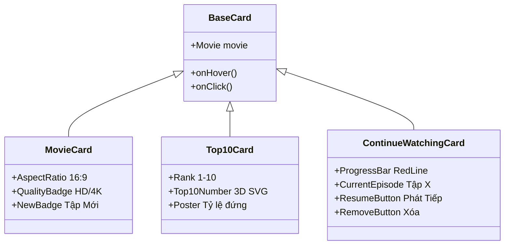

# 🎞️ 03.6 - MovieRow & Cards Components

<< [[03.5 - MovieModal Component|<< Trước: MovieModal]] | [[00 - NetLix Brain - Map of Content (MOC)|Trang Chủ MOC]] | [[03.7 - Navbar & Search Components|Tiếp: Navbar & Search >>]]

---

## 🎠 1. Hàng Phim Trượt Ngang (`MovieRow.tsx`)
Hàng phim là khối xây dựng cơ bản của trang chủ Netflix:
- **Cuộn ngang mượt mà (Smooth Horizontal Scroll)**:
  - Sử dụng CSS `overflow-x: scroll` kết hợp `scrollbar-width: none` để ẩn hoàn toàn thanh cuộn thô của trình duyệt.
  - Các nút mũi tên trái/phải tính toán chiều rộng của khung nhìn (`rowRef.current.clientWidth * 0.75`) để trượt một khoảng vừa phải khi nhấp.
- **Che mờ viền (Edge Vignette Gradients)**:
  - Khi cuộn, hai bên mép có hiệu ứng gradient đen mờ dần để tạo cảm giác hàng phim trải dài vô tận.

---

## 🃏 2. Hệ Thống Các Loại Thẻ Phim (Card Types)

### 2.1 `MovieCard.tsx` (Thẻ Phim Chuẩn Dạng Ngang - Landscape)
- Tỷ lệ khung hình **16:9** (ngang) chuẩn điện ảnh: toàn bộ các hàng phim thông thường (quốc gia, thể loại, nền tảng) đều sử dụng dạng ngang để đạt độ đồng bộ tuyệt đối giống Netflix.
- **Huy hiệu thông minh (Smart Badges)**:
  - *"Tập mới"*: Chỉ hiển thị khi phim bộ có tập mới ra mắt.
  - *"Mới thêm"*: Chỉ hiển thị cho các phim mới cập nhật gần đây (trong vòng 10 ngày). Các phim cũ hoàn toàn không bị gán tag nhảm.
  - *"Top Platform Badge"*: Đối với phim thuộc Top của các nền tảng sẽ có logo thương hiệu riêng: `TOP 10` (Netflix), `tv TOP 10`, `Disney+ TOP 10`, `HBO TOP 10`, `prime TOP 10`.

### 2.2 `Top10Card.tsx` (Thẻ Phim Top 10 Dạng Dọc - Portrait)
- **Độc quyền cho các hàng Top 10**: Chỉ duy nhất các hàng Top 10 (ví dụ: *Top 10 Series tại VN*, *Top 10 Phim lẻ tại VN*) mới sử dụng thẻ dạng dọc tỉ lệ `2:3`.
- Thiết kế biểu tượng của Netflix: Phía bên trái mỗi thẻ là một con số từ 1 đến 10 cỡ lớn được vẽ bằng vector SVG nghệ thuật (`components/ui/Top10Number.tsx`) với hiệu ứng viền 3D màu xám/trắng nổi bật trên nền đen.

### 2.3 `ContinueWatchingCard.tsx` (Thẻ Tiếp Tục Xem)
- Dành riêng cho hàng "Tiếp tục xem của bạn".
- Có thanh tiến trình màu đỏ ở cạnh đáy thẻ phản ánh chính xác % thời gian đã xem.
- Nút tròn Play ở trung tâm giúp tiếp tục xem ngay mà không cần qua bước trung gian.
- Nút dấu `X` ở góc phải cho phép xóa phim khỏi lịch sử xem. Hỗ trợ prop `fillWidth` khi đặt trong trang `/my-list`.
