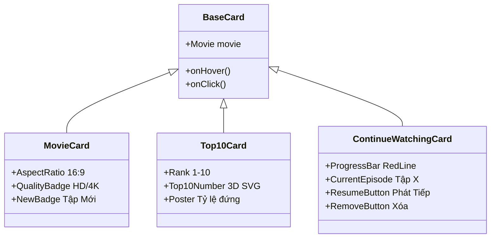

# 🎞️ 03.6 - MovieRow & Cards Components

<< [[03.5 - MovieModal Component|<< Trước: MovieModal]] | [[00 - NetLix Brain - Map of Content (MOC)|Trang Chủ MOC]] | [[03.7 - Navbar & Search Components|Tiếp: Navbar & Search >>]]

---

## 🎠 1. Hàng Phim Trượt Ngang (`MovieRow.tsx`)
Hàng phim là khối xây dựng cơ bản của trang chủ Netflix:
- **Cuộn ngang mượt mà (Smooth Horizontal Scroll)**:
  - Sử dụng CSS `overflow-x: scroll` kết hợp `scrollbar-width: none` để ẩn hoàn toàn thanh cuộn thô của trình duyệt.
  - Các nút mũi tên trái/phải tính toán chiều rộng của khung nhìn (`rowRef.current.clientWidth * 0.75`) để trượt một khoảng vừa phải khi nhấp.
- **Che mờ viền (Edge Vignette Gradients)**:
  - Khi cuộn, hai bên mép có hiệu ứng gradient đen mờ dần để tạo cảm giác hàng phim trải dài vô tận.

---

## 🃏 2. Hệ Thống Các Loại Thẻ Phim (Card Types)

### 2.1 `MovieCard.tsx` (Thẻ Phim Chuẩn)
- Tỷ lệ khung hình **16:9** chuẩn điện ảnh.
- Hiển thị nhãn huy hiệu (Badges) như: *"Tập mới"*, *"Mùa mới"*, *"Mới thêm"*.
- Xử lý ảnh lỗi (`onError`): Nếu link ảnh NguonC bị lỗi hoặc die, tự động chuyển về ảnh dự phòng chất lượng cao từ Unsplash để giao diện luôn hoàn mỹ.

### 2.2 `Top10Card.tsx` (Thẻ Phim Top 10)
- Thiết kế biểu tượng của Netflix: Phía bên trái mỗi thẻ là một con số từ 1 đến 10 cỡ lớn được vẽ bằng vector SVG nghệ thuật (`components/ui/Top10Number.tsx`).
- Số 1 đến 10 có hiệu ứng đổ bóng viền 3D màu xám/trắng nổi bật trên nền đen.

### 2.3 `ContinueWatchingCard.tsx` (Thẻ Tiếp Tục Xem)
- Dành riêng cho hàng "Tiếp tục xem của bạn".
- Có thanh tiến trình màu đỏ ở cạnh đáy thẻ phản ánh chính xác % thời gian đã xem.
- Nút tròn Play ở trung tâm giúp tiếp tục xem ngay mà không cần qua bước trung gian.
- Nút dấu `X` ở góc phải cho phép xóa phim khỏi lịch sử xem.
