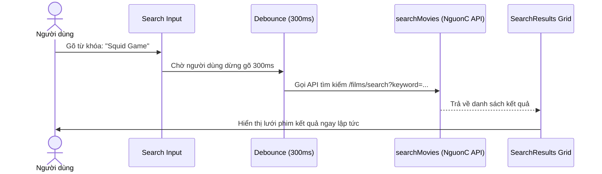

# 🧭 03.7 - Navbar & Search Components

<< [[03.6 - MovieRow & Cards Components|<< Trước: MovieRow & Cards]] | [[00 - NetLix Brain - Map of Content (MOC)|Trang Chủ MOC]] | [[03.8 - Auth & Account Management Components|Tiếp: Auth & Account Management >>]]

---

## 🖤 1. Thanh Điều Hướng Thông Minh (`Navbar.tsx`)

### 1.1 Hiệu Ứng Nền Động Khi Cuộn (Dynamic Background)
- Khi ở vị trí trên cùng (`scrollY <= 30px`): Navbar hoàn toàn trong suốt với gradient đen nhẹ ở đỉnh, hòa lẫn tuyệt đối vào `HeroBanner`.
- Khi người dùng cuộn xuống (`scrollY > 30px`): Navbar chuyển sang màu nền đen bóng mờ kính (`bg-[#141414]/95 backdrop-blur-md`) với viền mờ phía dưới.

### 1.2 Hệ Thống Menu Điều Hướng
- **Trang chủ** (`/`)
- **Phim T.hình / Series** (`/series`)
- **Phim lẻ** (`/movies`)
- **Mới & Phổ biến** (`/latest`)
- **Danh sách của tôi** (`/my-list`)

---

## 🔎 2. Thanh Tìm Kiếm Thời Gian Thực (Live Debounced Search)

- **Mở rộng mượt mà**: Ô tìm kiếm ban đầu chỉ là một icon kính lúp. Khi nhấp vào, nó trượt mở rộng sang một ô nhập liệu có viền sáng.
- **Debounce 300ms**: Tránh việc gửi request liên tục lên API sau mỗi phím gõ.
- **Chế độ xem SearchResults**: Khi có từ khóa tìm kiếm (`searchQuery.length > 0`), toàn bộ trang chủ được thay thế bằng giao diện lưới kết quả tìm kiếm với các bộ lọc theo quốc gia và thể loại.
- **Xóa nhanh**: Nút `X` giúp xóa sạch từ khóa và quay lại trang chủ tức thì.

---

## 👤 3. Menu Hồ Sơ Người Dùng (Profile Dropdown)
Ở góc phải của Navbar:
- Avatar tài khoản phong cách Netflix với viền màu đỏ.
- Khi rê chuột vào: Menu thả xuống hiển thị:
  - Tên người dùng và nhãn vai trò (`Admin` hoặc `Member`).
  - Nút **"Quản lý tài khoản"** (chỉ hiển thị với Admin) mở modal tạo tài khoản.
  - Nút **"Đăng xuất"** gọi `/api/auth/logout` và chuyển hướng về trang `/login`.
