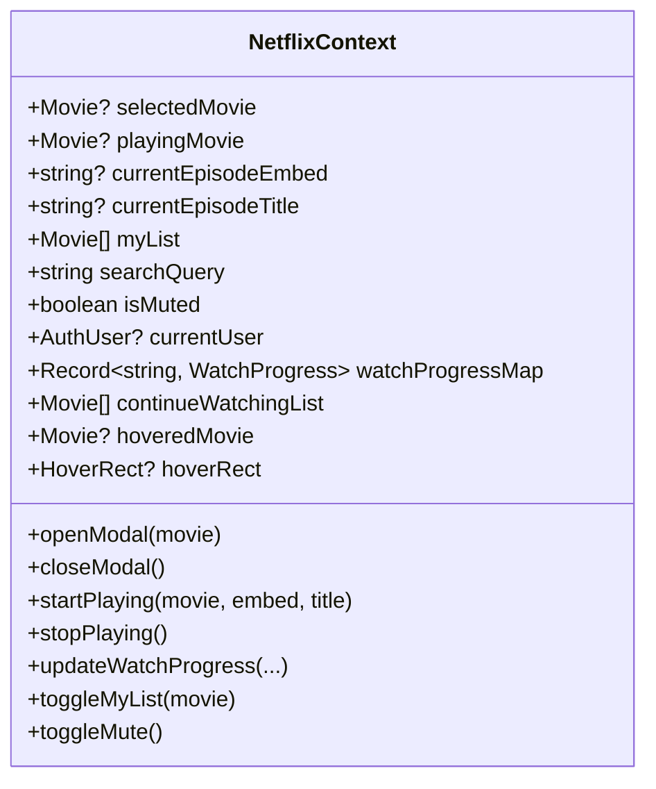

# 🧠 04.1 - NetflixContext (State Toàn Cục)

<< [[03.8 - Auth & Account Management Components|<< Trước: Auth Components]] | [[00 - NetLix Brain - Map of Content (MOC)|Trang Chủ MOC]] | [[04.2 - movieApi Service (Logic Xu Ly Du Lieu)|Tiếp: movieApi Service >>]]

---

## 🏛️ 1. Tổng Quan Về NetflixContext
Nằm tại `context/NetflixContext.tsx`, **NetflixContext** là hệ thống thần kinh trung ương quản lý toàn bộ trạng thái của ứng dụng thông qua React Context API và hook tùy biến `useNetflix()`.



---

## 📋 2. Bảng Danh Sách State & Chức Năng

| Tên State | Kiểu Dữ Liệu | Mục Đích Sử Dụng |
| :--- | :--- | :--- |
| `selectedMovie` | `Movie \| null` | Phim đang được mở trong `MovieModal` |
| `playingMovie` | `Movie \| null` | Phim đang phát trong `VideoPlayerModal` |
| `currentEpisodeEmbed` | `string \| null` | URL embed iframe của tập phim đang xem |
| `currentEpisodeTitle` | `string \| null` | Tên của tập phim đang xem (ví dụ: "Tập 3") |
| `myList` | `Movie[]` | Danh sách phim yêu thích của người dùng |
| `searchQuery` | `string` | Từ khóa tìm kiếm hiện tại |
| `isMuted` | `boolean` | Trạng thái tắt/bật âm thanh toàn trang |
| `trailerVolume` | `number` | Mức âm lượng phát trailer (0 - 100%, mặc định 60%) |
| `currentUser` | `AuthUser \| null` | Thông tin người dùng đang đăng nhập |
| `watchProgressMap` | `Record<string, WatchProgress>` | Bản đồ lưu toàn bộ tiến trình xem của các phim |
| `continueWatchingList`| `Movie[]` | Danh sách các phim đang xem dở |
| `hoveredMovie` | `Movie \| null` | Phim đang được rê chuột kích hoạt popout |
| `hoverRect` | `HoverRect \| null` | Tọa độ màn hình của card đang được hover |

---

## 🔄 3. Cơ Chế Đồng Bộ Tiến Trình Xem Phim (Multi-Tier Sync)

Hàm `updateWatchProgress` thực hiện đồng bộ 3 tầng:

```typescript
const updateWatchProgress = useCallback(
  (movie: Movie, currentTime: number, duration: number, episodeTitle?: string, episodeEmbed?: string) => {
    // 1. Cập nhật state React ngay lập tức (Local UI phản hồi 0ms)
    setWatchProgressMap((prev) => {
      const nextMap = { ...prev, [key]: newRecord };
      
      // 2. Lưu vào localStorage để người dùng tải lại trang không bị mất
      localStorage.setItem(`netflix_watch_progress_${username}`, JSON.stringify(nextMap));
      
      return nextMap;
    });

    // 3. Gửi bất đồng bộ lên Firebase qua API /api/user/progress
    fetch('/api/user/progress', {
      method: 'POST',
      headers: { 'Content-Type': 'application/json' },
      body: JSON.stringify({ key, progress: newRecord }),
    }).catch(console.error);
  },
  [currentUser]
);
```

---

## 🛡️ 4. Điều Phối Hover Tránh Xung Đột (Coordination)
Khi người dùng rê chuột nhanh giữa nhiều thẻ phim, các sự kiện `mouseenter` và `mouseleave` có thể xảy ra bất đồng bộ gây lỗi chớp tắt. `NetflixContext` điều phối qua các cờ:
- `onCardHover(movie, rect)`: Lưu phim và tọa độ.
- `onCardLeave()`: Kích hoạt timer chờ 300ms.
- `onPopoutEnter()`: Hủy timer đóng nếu chuột đã di chuyển an toàn vào trong thẻ popout.
- `closeHoverPopoutNow()`: Đóng ngay lập tức khi mở modal hoặc khi bắt đầu phát phim.
