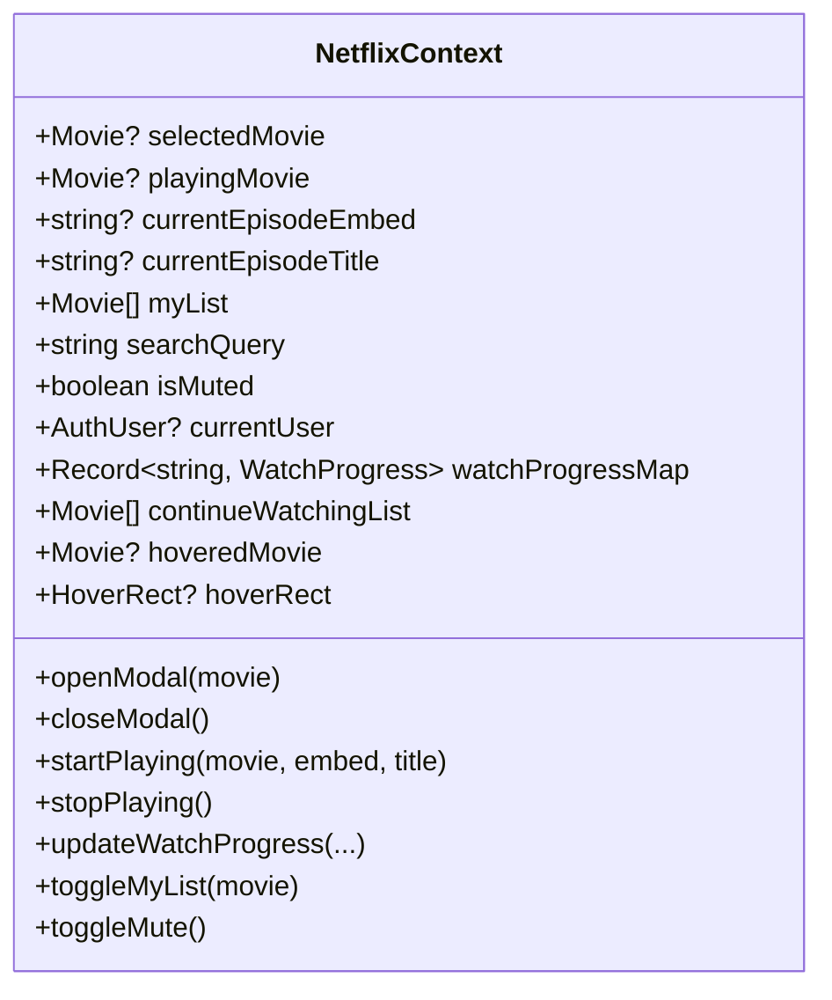

# 🧠 04.1 - NetflixContext (State Toàn Cục)

<< [[03.8 - Auth & Account Management Components|<< Trước: Auth Components]] | [[00 - NetLix Brain - Map of Content (MOC)|Trang Chủ MOC]] | [[04.2 - movieApi Service (Logic Xu Ly Du Lieu)|Tiếp: movieApi Service >>]]

---

## 🏛️ 1. Tổng Quan Về NetflixContext
Nằm tại `context/NetflixContext.tsx`, **NetflixContext** là hệ thống thần kinh trung ương quản lý toàn bộ trạng thái của ứng dụng thông qua React Context API và hook tùy biến `useNetflix()`.

---

## 📋 2. Bảng Danh Sách State & Chức Năng

| Tên State | Kiểu Dữ Liệu | Mục Đích Sử Dụng |
| :--- | :--- | :--- |
| `selectedMovie` | `Movie \| null` | Phim đang được mở trong `MovieModal` |
| `playingMovie` | `Movie \| null` | Phim đang phát trong `VideoPlayerModal` |
| `currentEpisodeEmbed` | `string \| null` | URL embed iframe của tập phim đang xem |
| `currentEpisodeTitle` | `string \| null` | Tên của tập phim đang xem (ví dụ: "Tập 3") |
| `myList` | `Movie[]` | Danh sách phim yêu thích của người dùng |
| `searchQuery` | `string` | Từ khóa tìm kiếm hiện tại |
| `isMuted` | `boolean` | Trạng thái tắt/bật âm thanh toàn trang |
| `trailerVolume` | `number` | Mức âm lượng phát trailer (0 - 100%, mặc định 60%) |
| `currentUser` | `AuthUser \| null` | Thông tin người dùng đang đăng nhập |
| `watchProgressMap` | `Record<string, WatchProgress>` | Bản đồ lưu toàn bộ tiến trình xem của các phim |
| `continueWatchingList`| `Movie[]` | Danh sách phim đang xem dở & các phim bộ có **Tập Mới** cần xem tiếp (tự động chuyển con trỏ sang tập mới, progress 0%, kèm badge `TẬP MỚI`) |
| `hoveredMovie` | `Movie \| null` | Phim đang được rê chuột kích hoạt popout |
| `hoverRect` | `HoverRect \| null` | Tọa độ màn hình của card đang được hover |

---

## 🔄 3. Cơ Chế Đồng Bộ Tiến Trình Xem & Danh Sách Phim (Database-Authoritative Sync)

Hệ thống quản lý trạng thái phim và tiến trình xem theo nguyên tắc **Database là nguồn chân lý tối cao (Single Source of Truth)** và **định danh phim cố định (Canonical Movie ID)**:

1. **Định danh cố định (Canonical ID)**:
   - Thay vì chỉ dựa vào `slug` (dễ bị biến thể như `tung-buoc-ben-nhau` vs `tung-buoc-ben-nhau-tien-si-yeu-dau`), hệ thống sử dụng hàm `getCanonicalMovieId` ưu tiên ID cố định từ API (`_id` MongoDB / PhimAPI / TMDB ID).
   - Hàm `isSameMovie` so khớp chéo đa tầng (ID cố định, TMDB ID, slug chuẩn hóa, hash CDN ảnh poster/backdrop, và tựa đề chuẩn hóa) giúp nhận diện chính xác 1 bộ phim ở mọi nơi.

2. **Ưu tiên Database (Cloud First)**:
   - `localStorage` chỉ đóng vai trò bộ đệm tạm (cache) để UI không bị giật khi vừa tải trang.
   - Khi API `/api/user/progress` hoặc `/api/user/mylist` trả về dữ liệu từ Firebase, dữ liệu đám mây sẽ giữ quyền ưu tiên và ghi đè các bản ghi cũ ở local.
   - Khi chuyển sang thiết bị khác, thiết bị mới tự động kéo tiến trình chính xác từ Database xuống và tiếp tục phát ngay tại giây đã xem dở.
   - Các bản ghi trùng lặp từ các thiết bị cũ sẽ tự động được gộp (`deduplicateWatchProgressMap`, `deduplicateMovies`) và tự động dọn dẹp các khóa dư thừa trên Firebase thông qua HTTP `DELETE`.

---

## 🛡️ 4. Điều Phối Hover Tránh Xung Đột (Coordination)
Khi người dùng rê chuột nhanh giữa nhiều thẻ phim, các sự kiện `mouseenter` và `mouseleave` có thể xảy ra bất đồng bộ gây lỗi chớp tắt. `NetflixContext` điều phối qua các cờ:
- `onCardHover(movie, rect)`: Lưu phim và tọa độ.
- `onCardLeave()`: Kích hoạt timer chờ 300ms.
- `onPopoutEnter()`: Hủy timer đóng nếu chuột đã di chuyển an toàn vào trong thẻ popout.
- `closeHoverPopoutNow()`: Đóng ngay lập tức khi mở modal hoặc khi bắt đầu phát phim.
