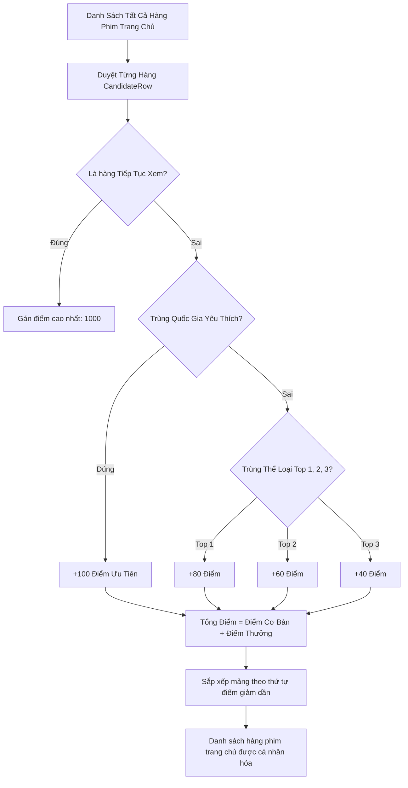

# 🤖 04.4 - recommendationEngine (Thuật Toán Đề Xuất)

<< [[04.3 - logoService (Logic Xu Ly TMDB Logo)|<< Trước: logoService]] | [[00 - NetLix Brain - Map of Content (MOC)|Trang Chủ MOC]] | [[04.5 - firebaseAdmin Library (Quan Ly Database)|Tiếp: firebaseAdmin >>]]

---

## 🔬 1. Giới Thiệu `services/recommendationEngine.ts`
Engine đề xuất của NetLix hoạt động hoàn toàn ở phía client và server Next.js mà không cần đến các hệ thống máy học (ML) cồng kềnh, mang lại tốc độ phản hồi tức thì với độ chính xác cao.

---

## 📐 2. Các Cấu Trúc Dữ Liệu Cốt Lõi

```typescript
export interface UserTasteProfile {
  topCountries: Record<string, number>;    // Điểm số theo slug quốc gia
  topGenres: Record<string, number>;       // Điểm số theo slug thể loại
  topActors: Record<string, number>;       // Điểm số theo tên diễn viên
  favoriteCountrySlug: string | null;      // Quốc gia được yêu thích nhất
  favoriteGenreSlugs: string[];            // Danh sách top 3 thể loại yêu thích
  totalWatched: number;                    // Tổng số phim đã xem
}

export interface CandidateRow {
  id: string;
  title: string;
  countrySlug?: string;
  genreSlug?: string;
  type: 'standard' | 'portrait' | 'continue';
  movies: Movie[];
  priorityBoost?: number;
}
```

---

## ⚙️ 3. Quy Trình Tính Điểm Hàng Phim



---

## 🛡️ 4. Xử Lý Trường Hợp Người Dùng Mới (Cold Start)
- Nếu người dùng mới lập tài khoản và `totalWatched === 0`:
  - `favoriteCountrySlug` là `null`.
  - Hệ thống tự động bỏ qua bước tính điểm cá nhân và hiển thị theo **thứ tự biên tập chuẩn của Netflix** (Phim Mới Cập Nhật $\rightarrow$ Top 10 Hôm Nay $\rightarrow$ Phim Hàn Quốc $\rightarrow$ Phim Hành Động $\rightarrow$ Anime).
