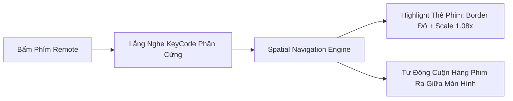
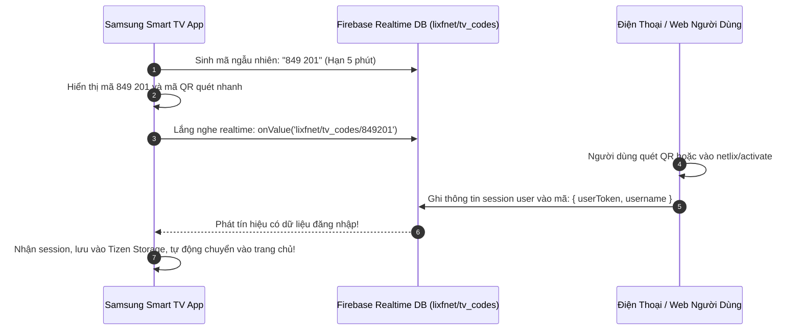

# 🚀 07.1 - Định Hướng Phát Triển Mobile & Samsung Smart TV (Tizen OS)

<< [[06.1 - Bang Tong Hop Loi & Cach Khac Phuc|<< Trước: Bảng Tổng Hợp Lỗi]] | [[00 - NetLix Brain - Map of Content (MOC)|Trang Chủ MOC]]

---

## 🎯 1. Tầm Nhìn Chiến Lược (Strategic Vision)

Mục tiêu dài hạn của **NetLix (Lixfnet)** là chuyển mình từ một ứng dụng Web Single-Page Application (SPA) thành một **Hệ sinh thái Streaming đa nền tảng (Cross-Platform Streaming Ecosystem)**:
1. **Web Portal** (Hiện tại): Máy tính để bàn, laptop, trình duyệt di động (Next.js 16).
2. **Mobile Apps**: Điện thoại & Máy tính bảng iOS / Android (Trải nghiệm chạm vuốt điện ảnh).
3. **Smart TV Apps**: Tivi thông minh Samsung (Tizen OS), LG (webOS), Android TV (Trải nghiệm xem tại phòng khách 10-foot UI).

Tài liệu này được lập ra để **bất kỳ lập trình viên hoặc AI nào sau này phát triển dự án** đều có thể đọc, hiểu ngay toàn bộ nghiệp vụ, rào cản kỹ thuật đặc thù, cách tổ chức code và các giải pháp kiến trúc đã được định hình trước.

---

## 📊 2. Ma Trận So Sánh Đặc Thù 3 Nền Tảng (Web vs. Mobile vs. Smart TV)

| Tiêu Chí | Web (Desktop / Laptop) | Mobile (iOS & Android) | Samsung Smart TV (Tizen OS) |
| :--- | :--- | :--- | :--- |
| **Thiết bị nhập liệu** | Chuột, bàn phím, touchpad | Cảm ứng đa điểm (Touch & Gestures) | **Chỉ có Remote D-Pad (Up, Down, Left, Right, OK, Back)** |
| **Khoảng cách nhìn** | Gần (50 - 70 cm) | Rất gần (20 - 40 cm) | **Xa (2.5 - 4 mét) $\rightarrow$ Yêu cầu "10-Foot UI"** |
| **Nguồn phát video** | `<iframe>` embed hoặc HTML5 | HLS `.m3u8` qua Native Player hoặc WebView | **Bắt buộc HLS `.m3u8` qua Tizen AVPlay / HTML5 Video** |
| **Cơ chế hover** | Rất mạnh (`HoverPopoutCard`) | Không có hover (Chỉ có Touch) | **Không có hover (Thay thế bằng Focus Ring / Scale 1.08x)** |
| **Điều hướng (Routing)**| URL pathname (`/movies`, `/login`) | Stack / Tab Navigator | **Spatial Navigation (Điều hướng không gian 2D)** |
| **Xác thực (Auth)** | Nhập form + Cookie HttpOnly | Form + Sinh trắc học (FaceID / Fingerprint) | **Link TV qua mã PIN 6 số hoặc quét QR Code** |
| **Hiệu năng phần cứng** | Rất mạnh (CPU đa nhân, GPU rời) | Mạnh mẽ (Apple A-series, Snapdragon) | **Yếu / Hạn chế (Tránh blur, shadow, cần ảo hóa DOM)** |

---

## 📺 3. SAMSUNG SMART TV (TIZEN OS) — ĐẶC TẢ KỸ THUẬT & NGHIỆP VỤ

### 3.1 Hệ Thống Điều Hướng Không Gian (Spatial Navigation) & Mã Phím Remote

#### Vấn đề:
Trên TV không có chuột. Khi người dùng bấm nút sang phải, tiêu điểm (focus) phải tự động nhảy từ thẻ phim này sang thẻ phim kế bên, hàng phim phải tự động cuộn sao cho thẻ đang focus luôn nằm ở vị trí dễ nhìn nhất.



#### Bảng Mã Phím Remote Samsung Tizen (Hardware Keycodes):
```typescript
export const TIZEN_KEY_CODES = {
  KEY_UP: 38,
  KEY_DOWN: 40,
  KEY_LEFT: 37,
  KEY_RIGHT: 39,
  KEY_ENTER: 13,
  KEY_RETURN: 10009,       // Nút "Back" trên remote Samsung (QUAN TRỌNG NHẤT)
  KEY_PLAY: 415,           // Nút Play chuyên dụng
  KEY_PAUSE: 19,           // Nút Pause chuyên dụng
  KEY_PLAY_PAUSE: 10252,   // Nút Play/Pause kết hợp
  KEY_FAST_FWD: 417,       // Nút tua tới >>
  KEY_REWIND: 412,         // Nút tua lui <<
  KEY_EXIT: 10182,         // Nút Exit thoát hẳn app
};
```

> [!CAUTION]
> **Quy Tắc Sống Còn Trên Tizen OS**:
> 1. Phải đăng ký nhận diện phím với hệ điều hành Tizen trước khi dùng:
>    ```javascript
>    if (window.tizen && window.tizen.tvinputdevice) {
>      window.tizen.tvinputdevice.registerKey('MediaPlayPause');
>      window.tizen.tvinputdevice.registerKey('MediaFastForward');
>      window.tizen.tvinputdevice.registerKey('MediaRewind');
>    }
>    ```
> 2. Phải bắt sự kiện `KEY_RETURN (10009)`: Nếu người dùng đang xem phim hoặc đang mở modal, bấm Back phải đóng modal / thoát player. Nếu đang ở Trang chủ, bấm Back mới hiển thị hộp thoại *"Bạn có muốn thoát NetLix?"*. Nếu không bắt sự kiện này, app sẽ bị văng đột ngột và bị Samsung từ chối duyệt lên Tizen Store!

#### Thư Viện Spatial Navigation Chuẩn:
Sử dụng thư viện **`@norigin-media/norigin-spatial-navigation`**:
- Mỗi thẻ phim là một Focusable component:
  ```tsx
  const { ref, focused } = useFocusable({
    onEnterPress: () => openModal(movie),
  });
  ```
- Khi `focused === true`, áp dụng class:
  `ring-4 ring-red-600 scale-108 shadow-[0_0_30px_rgba(229,9,20,0.8)] z-50`

---

### 3.2 Vấn Đề Luồng Video Iframe NguonC & Giải Pháp Cho Smart TV

#### Rào Cản Lớn Nhất Của Hệ Thống Hiện Tại:
- NguonC cung cấp luồng phát qua đường dẫn `embed` iframe (ví dụ: `https://embed.nguonc.com/...`).
- **Trên Smart TV, Remote không thể focus vào bên trong một `<iframe>` cross-origin!** Người dùng TV không thể dùng remote để bấm nút Play, Pause, hoặc kéo thanh tua của iframe.

#### Giải Pháp Kỹ Thuật (Architecture Solution):
1. **Phương Án Khuyên Dùng (Trích Xuất Luồng HLS `.m3u8`)**:
   - Viết một API Route trên backend (hoặc Cloudflare Worker) phân tích trang embed của NguonC để bóc tách luồng phát gốc định dạng **HLS (`.m3u8`)**.
   - Khi có link `.m3u8`, truyền trực tiếp vào:
     - **Tizen Web App**: Dùng API giải mã phần cứng native của Samsung: `webapis.avplay` (tối ưu nhất, mượt nhất, hỗ trợ 4K 60fps).
     - **React Native TV**: Dùng `react-native-video` với engine ExoPlayer.
   - Khi đó, toàn bộ giao diện điều khiển (Play/Pause, Thanh tua 10 giây, Chọn tập, Chọn phụ đề) sẽ do chính ta tự vẽ bằng HTML/React và bắt phím remote dễ dàng 100%!
2. **Phương Án Tạm Thời (Custom WebView Pointer)**:
   - Nếu bắt buộc dùng iframe: Giả lập một con trỏ chuột ảo trên màn hình TV điều khiển bằng các nút D-Pad của remote (tương tự trình duyệt Web của Tizen). Tuy nhiên phương án này trải nghiệm người dùng kém hơn.

---

### 3.3 Thiết Kế Giao Diện 10-Foot UI (10-Foot Experience)

Người dùng ngồi xem TV cách xa từ 2.5 đến 4 mét:
- **Kích thước chữ (Typography)**:
  - Tiêu đề phim: Tối thiểu `36px` đến `48px`.
  - Tóm tắt nội dung: Tối thiểu `20px` đến `24px` (font chữ đậm nét, dễ đọc trên nền tối).
- **Quy tắc bố cục hàng phim**:
  - Không nhét quá nhiều phim: Mỗi hàng chỉ hiển thị **5 đến 6 thẻ phim** cùng lúc trên màn hình độ phân giải 1080p/4K.
  - Khi thẻ phim được focus: Tự động phát video trailer xem trước (Preview) ở góc trên hoặc ngay trên thẻ sau 1 giây.

---

### 3.4 Tối Ưu Hóa Hiệu Năng Cho Chip Xử Lý TV (Performance Optimization)

1. **Tuyệt đối không dùng CSS `backdrop-filter: blur(...)`**:
   - Hiệu ứng làm mờ nền kính (glassmorphism) rất tốn tài nguyên GPU trên TV, có thể làm tụt FPS từ 60 xuống 15 fps. Thay vào đó, dùng màu nền solid đen mờ: `rgba(20, 20, 20, 0.95)`.
2. **Tránh Box-Shadow phức tạp**: Thay bóng đổ mờ bằng viền sáng đơn sắc (`border: 3px solid #E50914`).
3. **Ảo hóa danh sách (List Virtualization)**:
   - Sử dụng cơ chế tái sử dụng DOM (Recycler View). Các thẻ phim ngoài vùng hiển thị của TV phải được unmount để tiết kiệm bộ nhớ RAM.

---

### 3.5 Cơ Chế Đăng Nhập Tiện Lợi: "Link with TV" (Mã 6 Số / QR Code)



**Lợi ích**: Người dùng không bao giờ phải gõ từng chữ cái email/mật khẩu bằng remote điều khiển TV!

---

## 📱 4. ỨNG DỤNG MOBILE (iOS & ANDROID) — ĐẶC TẢ KỸ THUẬT & NGHIỆP VỤ

### 4.1 Hệ Thống Cử Chỉ Điện Ảnh (Cinema Touch Gestures)

```
        ┌──────────────────────────────────────────────┐
        │                 VIDEO AREA                   │
        │                                              │
        │   [Vuốt Trái: Độ Sáng]     [Vuốt Phải: Âm Lượng]
        │         ▲                        ▲           │
        │         │                        │           │
        │         ▼                        ▼           │
        │                                              │
        │   [Double Tap Nửa Trái]    [Double Tap Nửa Phải]
        │       << Tua -10s               Tua +10s >>   │
        └──────────────────────────────────────────────┘
```

1. **Điều khiển vuốt cạnh (Edge Swiping)**:
   - Nửa bên trái màn hình: Vuốt lên/xuống điều chỉnh độ sáng màn hình (`ScreenBrightness API`).
   - Nửa bên phải màn hình: Vuốt lên/xuống điều chỉnh âm lượng (`SystemSetting.setVolume`).
2. **Chạm đúp tua nhanh (Double Tap to Seek)**:
   - Chạm đúp bên trái: Tua lùi 10s kèm animation gợn sóng và chữ `<< 10s`.
   - Chạm đúp bên phải: Tua tới 10s kèm animation `10s >>`.
3. **Pinch-to-Zoom (Tỷ lệ co giãn khung hình)**:
   - Búng tay để chuyển đổi giữa 3 chế độ:
     - `Fit`: Hiển thị trọn vẹn 100% video (có thể có viền đen trên dưới).
     - `Fill`: Phóng to lấp đầy màn hình tràn viền (tai thỏ / Dynamic Island).
     - `16:9` hoặc `21:9`: Tỷ lệ điện ảnh nguyên bản.
4. **Swipe Down to Picture-in-Picture (PiP)**:
   - Vuốt nhẹ video xuống góc dưới bên phải để thu nhỏ thành mini-player, người dùng có thể vừa nghe âm thanh phim vừa lướt tìm tựa phim khác.

---

### 4.2 Xoay Màn Hình Native Chuẩn Xác
- Không dùng hack CSS matrix (`transform: rotate(90deg)`).
- Sử dụng thư viện `react-native-orientation-locker`:
  - Khi bấm nút Play: Tự động chuyển chế độ hiển thị sang ngang `Orientation.lockToLandscape()`.
  - Khi bấm nút Thoát: Trả về chế độ màn hình dọc `Orientation.unlockAllOrientations()`.

---

### 4.3 Thông Báo Đẩy Thông Minh (Push Notifications via FCM)
- Tích hợp **Firebase Cloud Messaging (FCM)**.
- Khi người dùng đánh dấu một bộ phim vào **"Danh sách của tôi"** (`myList`):
  - Hệ thống tự động đăng ký topic `movie_{slug}`.
  - Khi API NguonC có tập mới (ví dụ phim ra Tập 7), Cloud Function tự động gửi thông báo đến điện thoại:
    > *"Đừng Bước Bên Nhau vừa ra mắt Tập 7! Xem ngay."*

---

## 🏛️ 5. KIẾN TRÚC TÁI SỬ DỤNG MÃ NGUỒN (CODE REUSE STRATEGY)

Để tiết kiệm 70% thời gian phát triển và không phải viết lại từ đầu, kiến trúc khuyên dùng là cấu trúc **Monorepo (Turborepo)**:

```
netlix-ecosystem/
├── packages/
│   ├── core/                    # DÙNG CHUNG 100% CHO WEB, MOBILE & TV
│   │   ├── services/
│   │   │   ├── movieApi.ts      # Toàn bộ logic gọi NguonC, phân tích thời lượng
│   │   │   ├── logoService.ts   # Logic tuyển chọn Title Logo TMDB
│   │   │   └── recommendation.ts# Thuật toán tính Taste Profile & gợi ý
│   │   ├── types/               # TypeScript interfaces (Movie, WatchProgress...)
│   │   └── firebase/            # Logic kết nối Firebase Realtime DB
│   └── ui-tokens/               # Màu sắc đỏ/đen Netflix, tỷ lệ, font chữ
├── apps/
│   ├── web/                     # ỨNG DỤNG WEB HIỆN TẠI (Next.js 16)
│   ├── mobile/                  # ỨNG DỤNG MOBILE (React Native / Expo)
│   └── tv-samsung/              # ỨNG DỤNG TIZEN SMART TV (React Native TV / Tizen Web App)
```

### Công Nghệ Khuyên Dùng:
- **Mobile**: **React Native (Expo)**.
- **Samsung Smart TV**:
  - *Cách 1 (Nhanh nhất)*: **Tizen Web Application** (Sử dụng React SPA xuất bản HTML/JS, nhúng `@norigin-media/norigin-spatial-navigation`, đóng gói bằng công cụ **Tizen Studio** thành file `.wgt` cài lên TV).
  - *Cách 2 (Hiệu năng cao nhất)*: **React Native for TV (`react-native-tvos`)**.

---

## 📅 6. LỘ TRÌNH THỰC HIỆN TỪNG BƯỚC (ROADMAP CHECKLIST)

### Giai Đoạn 1: Chuẩn Hóa Tầng Dữ Liệu & Nguồn Phát
- [ ] Tách thư mục `services/` và `types/` thành module độc lập có thể import cho mọi nền tảng.
- [ ] Xây dựng API bóc tách trực tiếp luồng stream `.m3u8` (HLS) để phục vụ Native Player cho Mobile & Smart TV.
- [ ] Xây dựng bảng `lixfnet/tv_codes` trên Firebase để chuẩn bị cho tính năng Link TV bằng mã PIN.

### Giai Đoạn 2: Xây Dựng Ứng Dụng Mobile (React Native)
- [ ] Cài đặt dự án React Native (Expo) với TypeScript.
- [ ] Tái sử dụng `movieApi.ts` và `NetflixContext.tsx`.
- [ ] Tích hợp `react-native-video` hỗ trợ cử chỉ vuốt âm lượng / độ sáng / tua 10 giây.
- [ ] Tích hợp thông báo đẩy Firebase Cloud Messaging (FCM).

### Giai Đoạn 3: Xây Dựng Ứng Dụng Samsung Smart TV (Tizen OS)
- [ ] Cài đặt **Tizen Studio** và Samsung TV Extension (giả lập TV trên máy tính).
- [ ] Tích hợp thư viện `@norigin-media/norigin-spatial-navigation` cho điều khiển remote D-Pad.
- [ ] Bắt mã phím phần cứng `KEY_RETURN (10009)` và các phím Media Play/Pause.
- [ ] Thiết kế giao diện 10-foot UI cỡ chữ lớn, bỏ toàn bộ CSS blur gây tụt FPS.
- [ ] Hoàn thiện luồng đăng nhập "Link with TV" bằng mã QR / PIN 6 chữ số.
