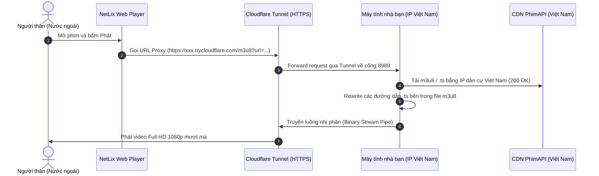

# 🌐 07.2 - Giải Pháp Proxy Streaming Cho Người Dùng Nước Ngoài

<< [[07.1 - Dinh Huong Phat Trien Mobile & Samsung Smart TV (Tizen)|<< Trước: Định Hướng Mobile & TV]] | [[00 - NetLix Brain - Map of Content (MOC)|Trang Chủ MOC]]

---

## 🎯 1. Bối Cảnh & Vấn Đề Nghiệp Vụ
- **Hiện tượng**: Các luồng phát video HLS (`.m3u8` và các phân đoạn `.ts`) từ API `phimapi.com` chỉ chạy được trong lãnh thổ Việt Nam. Khi người dùng ở nước ngoài (Mỹ, Nhật, Châu Âu, v.v.) mở phim, video sẽ bị lỗi `403 Forbidden` hoặc `Timeout` do tường lửa CDN của bên cung cấp chặn IP quốc tế (để tiết kiệm băng thông quốc tế và né tránh rà quét bản quyền DMCA).
- **Yêu cầu người dùng**:
  - Người thân ở nước ngoài chỉ việc vào website xem bình thường, **không cần cài đặt VPN hay fake IP**.
  - Không tốn chi phí thuê VPS đắt đỏ vì chỉ có 1–2 người xem.
  - Phải có cơ chế **bật / tắt dễ dàng bằng 1 click** trên máy tính cá nhân ở Việt Nam (khi nào người nhà cần xem thì bật, xem xong thì tắt ngay để giải phóng 100% tài nguyên).

---

## 🏗️ 2. Kiến Trúc Kỹ Thuật (Home Node + Cloudflare Tunnel)

---

## ⚡ 3. Các Thành Phần Đã Xây Dựng

Hệ thống đã được trang bị sẵn 3 thành phần trực tiếp trong thư mục dự án:

1. **`scripts/stream-proxy.mjs`**:
   - Máy chủ proxy Node.js thuần (không cần cài thêm npm packages).
   - Tự động gắn header CORS (`Access-Control-Allow-Origin: *`).
   - Tự động **Rewrite M3U8**: Đọc file playlist gốc và biến đổi toàn bộ link phân đoạn `.ts` sang endpoint `/ts?url=...` đi qua proxy.
   - Truyền luồng trực tiếp (Memory Stream Pipe) với định dạng `video/MP2T`, không ghi vào ổ cứng $\rightarrow$ **RAM chỉ tốn ~30MB, CPU < 1%**.

2. **`start-proxy.bat`** *(Bật bằng 1 click)*:
   - Tự động chạy script proxy ngầm tại cổng `8989`.
   - Tự động kích hoạt `cloudflared tunnel` để xuất bản URL HTTPS ra toàn cầu mà **không cần mở cổng modem (Port Forwarding)**.

3. **`stop-proxy.bat`** *(Tắt bằng 1 click)*:
   - Tự động dọn dẹp và tắt toàn bộ tiến trình `cloudflared.exe` và tiến trình chiếm cổng `8989`.
   - Trả lại 100% tài nguyên và RAM cho máy tính ngay lập tức.

---

## 📋 4. Hướng Dẫn Từng Bước Vận Hành (Cho Người Dùng)

### Bước 1: Tải công cụ Cloudflare Tunnel (Chỉ làm 1 lần duy nhất)
1. Tải file **`cloudflared-windows-amd64.exe`** từ trang Cloudflare:
   👉 **https://github.com/cloudflare/cloudflared/releases/latest**
2. Đặt file vào ngay thư mục dự án: `c:\Users\trong\Downloads\Code\NetLix\netlix\` (để nguyên tên `cloudflared-windows-amd64.exe` hoặc đổi thành `cloudflared.exe` đều được, script tự động nhận diện cả 2).

---

### Bước 2: Khi người nhà muốn xem phim (Cấu hình gọn gàng)
1. Bạn nhấp đúp file **`start-proxy.bat`** trên máy tính tại Việt Nam để mở cổng truyền video.
2. Copy link `https://xxxx.trycloudflare.com` gửi cho người nhà.
3. Người nhà mở web NetLix trên máy của họ:
   - Nhấp vào **Avatar góc trên bên phải** $\rightarrow$ chọn **"Proxy xem từ nước ngoài"** (hoặc nút **Cài đặt**).
   - Dán đường dẫn vừa nhận vào ô nhập $\rightarrow$ Bấm **"Lưu cấu hình"**.
   - *(Tùy chọn: có nút "Kiểm tra" để người nhà thử xem máy tính ở VN có đang bật không)*.
4. **Cơ chế lưu trữ**: Máy nào lưu máy đấy (100% trong `localStorage` của trình duyệt người đó), không gửi lên server, không ảnh hưởng đến người khác. Khi lưu xong là mở phim xem mượt mà!

---

### Bước 3: Khi người nhà xem xong (Tắt 1 click)
- Bạn chỉ cần **đóng cửa sổ dòng lệnh** lại, hoặc nhấp đúp vào file: **`stop-proxy.bat`**.
- Mọi tiến trình dừng ngay lập tức, không tốn 1 byte RAM hay CPU nào nữa.

---

## 📦 5. Tính Di Động Độc Lập: Có Cần Giữ Lại Cả Folder Dự Án Không?
- **Nếu xóa sạch hoàn toàn cả máy**: Sẽ **KHÔNG THỂ BẬT ĐƯỢC**. Lý do: Vercel đặt máy chủ tại Mỹ/Singapore nên Vercel vẫn bị coi là IP nước ngoài. Phải có máy tính ở Việt Nam chạy proxy thì người thân mới mượn được IP Việt Nam.
- **Giải pháp dọn dẹp dung lượng (Đóng gói siêu gọn ~35MB)**:
  - Bạn **KHÔNG CẦN** giữ lại toàn bộ thư mục dự án Next.js khổng lồ (vài trăm MB `node_modules`, `.next`, source code...).
  - Sau khi deploy lên Vercel, bạn chỉ cần copy riêng **4 file** sau vào 1 folder nhỏ ở Desktop (ví dụ: `C:\NetLix-Proxy`):
    1. `cloudflared.exe` (~35MB)
    2. `stream-proxy.mjs` (~4KB)
    3. `start-proxy.bat` (~1KB)
    4. `stop-proxy.bat` (~1KB)
  - Khi nào người nhà cần xem, bạn chỉ cần mở folder nhỏ 35MB này lên bấm `start-proxy.bat` là xong!

